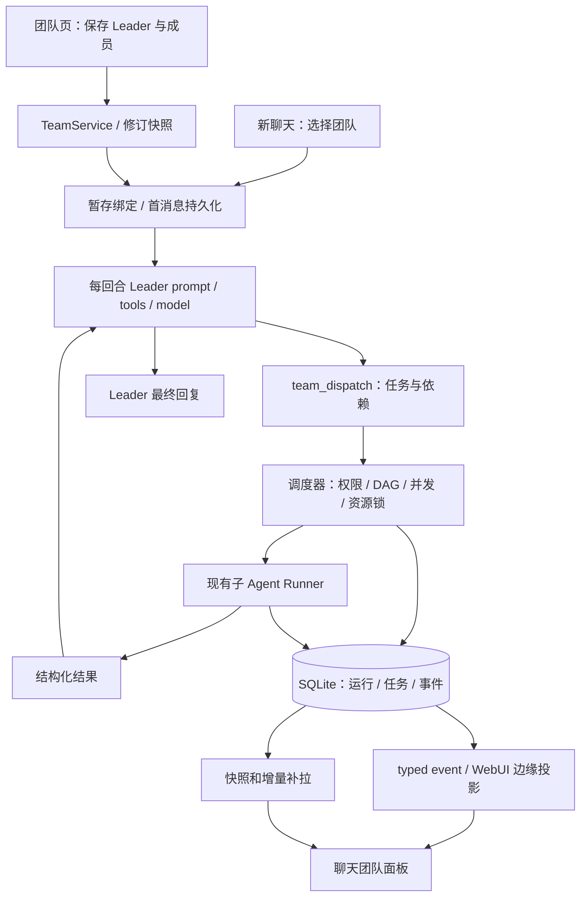

# Agent Team 详细实施计划

> **For agentic workers:** 本文件是待审阅计划，不是实施授权。用户确认后使用项目 `orchestration`，按同 stem dispatch 分组实施；步骤使用 checkbox 跟踪。不得在全局 Loop 上直接修改单个 Team 的 prompt、工具或模型。

**Goal:** 用户能够创建包含 Leader 和成员的团队，在新聊天中选择团队，并实时查看 Leader 和成员正在处理什么，最终由 Leader 汇总结果。

**Architecture:** 新增 `nanobot/teams/` 管理团队修订、会话绑定、任务调度和持久事件。复用现有 AgentProfile、主聊天 Loop 和子 Agent Runner；Leader 的 `team_dispatch` 以批次提交 DAG，由宿主验证和并发执行，实时状态独立经 typed event 投影到 WebUI。

**Tech Stack:** Python >=3.11、asyncio、标准库 sqlite3、既有 filelock、React 18、TypeScript、Vitest。具体版本见 stack 文档；不新增框架/服务依赖。

**交付边界:** 本轮交付调研、候选契约和计划；没有批准任何业务实现，也没有运行应用测试。以下测试代码是实施时的验收起点，测试名和新增 API 均为计划接口。

## 1. 产品行为与范围

### 1.1 对应三项需求

| 用户需求 | 首版行为 | 可验收结果 |
| --- | --- | --- |
| 创建团队、配置 Leader/子 Agent | 设置增加「团队」页；从已有 Agent 档案选一个 Leader、1..8 个成员，填写团队说明和各成员职责，编辑/复制/归档 | 保存后刷新仍存在；重复成员、无 Leader、被 Leader 禁止的成员不能保存 |
| 创建聊天时指定团队 | 空聊天输入区增加「普通聊天 / 团队」选择器，显示 Leader 和成员摘要；首消息前绑定服务端解析的团队修订 | 第一条消息就使用指定 Leader；聊天列表/页头显示团队；刷新、重连不丢绑定 |
| 显示各 Agent 的进度 | 每个请求出现团队运行面板，展示 Leader 阶段、成员任务、排队/执行/完成/失败、最近动作、耗时、结果 | 两个并行成员分别更新卡片；可停止整个团队或单项任务；历史可查看最终状态 |

已确认第一版是「Leader 分派、成员执行、Leader 汇总，并展示实时进度」。以下放入后续独立计划：成员互发消息/自主领任务、跨请求常驻成员会话、多层 Leader/嵌套团队、跨设备分布式执行、流程画布、精确费用预估。

第一版允许 Leader 对简单问题直接作答，不为展示团队而强制唤醒全部成员。实际派发时才出现成员执行记录；待命成员不计为失败或未完成任务。

团队运行中继续发送普通消息时显示「已排队」，在当前运行结束后开启新的 Leader 回合；停止等控制按钮即时生效，不排在聊天消息后。首版不把新消息注入已经派发的成员上下文，避免同一运行的目标在中途无记录地改变。

### 1.2 页面与交互

团队设置页沿用 AgentsView 的卡片、搜索、对话框和颜色体系。保留 Agent 档案页；团队页编辑成员引用和职责，不复制工具/技能编辑器。

```text
设置 / 团队
  [+ 创建团队]   [搜索团队]
  内容团队                  Leader：主编
  研究员 / 撰稿人 / 审校员   最多并行 3 项
  [编辑] [复制] [归档]

新聊天
  工作空间：当前项目    对话方式：[团队：内容团队 v2 ▾]
  Leader：主编 · 成员：研究员、撰稿人、审校员
  [输入任务并发送]

聊天中的团队运行
  内容团队 v2 · 本轮运行                    [停止团队]
  主编       等待成员结果
  研究员     执行中   查阅资料 · 最近动作：检索文档   18s
  撰稿人     排队中   等待「研究资料」完成
  审校员     待命
  当前任务：已完成 0 / 2                    [展开详情]
```

团队页提供空态「先创建 Agent 档案，再组建团队」，可直接打开已有 Agent 管理入口。保存错误在字段旁显示；版本冲突提示重新加载，保留本地草稿，不覆盖别人编辑。

运行面板默认展开执行中的成员；完成后折叠为摘要，仍可展开。失败保留可读原因和成功成员结果。窄屏放在聊天流内，不要求额外桌面窗口；键盘能展开卡片、访问停止按钮；状态同时使用文字和图标，不只靠颜色。

不展示私有推理，不把模型正在生成理解为真实「完成 70%」。阶段、工具名称和已完成任务数来自执行事件。工具参数与输出只展示已经脱敏的摘要。

### 1.3 团队变化与已有聊天

采用**修订固定**：创建聊天绑定 Team v2；修改团队/Agent 后需保存 Team v3，新聊天默认选 v3，已有聊天继续 v2。页头可提示新版本并提供「用新版新建聊天」。首版不在有消息的聊天中换团队，避免上下文和权限被静默替换。

运行快照保存完整档案约束但不存凭据；模型 preset 每次运行重新解析可用性，禁止悄悄改用默认模型。档案缺失/隐藏、团队归档、preset 失效时阻止新运行并给修复入口，历史仍可读。正在运行的快照不被团队编辑打断。

普通无 Team 聊天、IM/CLI 的已有 spawn 行为保持原接口。临时聊天首版不启用 Team；fork 若已有入口则继承固定绑定，不继承后台任务或 runId。

## 2. 方案取舍与现有基础

推荐「独立 Team 领域 + 既有运行时」。直接复用 `AgentProfile.subAgents` 只能表达候选能力，不足以表达可复用团队、修订和运行。引入完整外部框架会造成双执行链、双取消和双持久化，本次没有必要。

调研依据：[Claude Code 团队任务与生命周期](https://code.claude.com/docs/en/agent-teams)、[LangChain supervisor/subagents](https://docs.langchain.com/oss/python/langchain/multi-agent/subagents)、[CrewAI 层级管理](https://docs.crewai.com/v1.15.28/en/learn/hierarchical-process)。这些资料提供参考模式；本计划中的接口/规模限制由本项目设计，不是照搬上游配置。

| 本地事实 | 基线锚点 | 对计划的影响 |
| --- | --- | --- |
| AgentProfile CRUD 和 WebUI 已实现 | `nanobot/agents/models.py:103`、`store.py:61`、`AgentsView.tsx:39` | 团队引用现有档案 |
| 档案 prompt/tools/skills 能影响子执行 | `subagent.py:530`、`agents/runtime.py:212` | 复用装配，但增加可信冻结档案入口 |
| `modelId` 选择器提供 preset 名，宿主未接 resolver | `agents_api.py:200`、`loop.py:422`、`model_runtime.py:117` | 将 preset 解析接入团队 Leader/成员；不从档案读凭据 |
| 空聊天先暂存、首消息才保存 session | `inbound_commands.py:307`、`ThreadShell.tsx:1477` | TeamBinding 同步暂存、首消息前保存，不顺便重构空聊天生命周期 |
| context/tools 为共享对象，TurnContext 有独立字段 | `loop.py:403,419,2080` | 仅填本回合 ctx.tools/runtime/attributes |
| `tools or self.tools` 存在空集退回漏洞 | `loop.py:1077,1454,2101` | 接权限之前先回归修复 |
| 子执行状态在完成后删除 | `subagent.py:421,487` | 另存 TeamTask/Attempt/Events，保留旧清理习惯 |
| `run_inline` 不 announce，适合批次聚合 | `subagent.py:480,625` | 防止旧 spawn 完成通知再次启动 Leader |
| 普通 progress 会被归并成整个轮次 trace | `useNanobotStream.ts:1114` | 新团队帧独立处理，不混入普通工具 trace |

## 3. 运行架构与数据流



1. Team 保存时检查 Leader/成员存在、引用不重复、成员符合 Leader.subAgents，并创建不可变修订。
2. 新聊天提交 team_id，服务端暂存解析后的绑定；首消息提交时持久化绑定，再开始模型调用。
3. `_restore_turn` 注入本回合工具，`_build_turn` 决定 Leader runtime，ContextBuilder 接收本回合的角色/技能参数。禁止变更全局对象。
4. Leader 通过 `team_dispatch(batchId,tasks)` 给出有限 DAG。宿主整批校验后入库；先创建任务再执行，不能模型一边声明一边启动导致半批非法。
5. 子 Agent 使用冻结档案、必要输入和项目 scope 执行。就绪任务并行，依赖未完成则等待；同成员串行；写同一资源串行。
6. 生命周期与公开工具动作先持久化，再发事件。网络慢/断开不阻塞或回滚模型执行。
7. 一批任务结束后结果一次回到 Leader；Leader 可以在预算内安排下一批，最终汇总。Leader 最终交付和任务终态共同确定 run 终态。
8. 客户端刷新/重连先获取快照及 lastSeq，再补事件。进程重启标记 interrupted，禁止盲目重放团队工具。

### 3.1 关键接口与数据

完整定义见 [接口契约](../contracts/2026-10-15-agent-team-contract.md)。分开保存 TeamDefinition、TeamRevisionSnapshot、TeamBinding、TeamRun、TeamTask、TeamAttempt、TeamEvent；AgentProfile 不承载运行状态。

Leader 只看到团队成员 ID/职责、必要工具和本轮任务结果；服务端注入 runId/session/snapshot。Team 模式移除普通 spawn，由 team_dispatch 统一限制成员。Leader 的普通工具按 core scope 过滤，成员按 subagent scope 过滤，不能把二者混为一个工具目录。

接口遵循现有「HTTP 读、认证 WS mutation 写」：teams.save/archive/clone、teamRuns.cancel/retry、teamTasks.cancel。外层现有错误 `{error:string}` 保留，通过固定错误码前缀区分失败；新增功能不改全站错误模型。

### 3.2 默认限制

| 限制 | 默认/上限 | 原因 |
| --- | --- | --- |
| Leader / 成员数 | 1 / 1..8 | 首版单层协作 |
| 团队并发 | 默认 3，最高 8 | 同时受现有全局 max_concurrent_subagents 限制 |
| 同一成员并发 | 1 | 避免一张卡混合多个执行与写冲突 |
| 每次运行任务数 | 16，最高 64 | 包括返工任务，不能靠重命名绕过 |
| 派单轮数 | 4，最高 8 | 防止反复拆解/返工 |
| 子任务 / 总运行超时 | 600s / 1800s | 含排队的总运行截止时间，子执行超时从启动计 |
| 活动推送 | 每任务每秒最多 4 条 | 不保存每 token 更新，终态立即落库 |
| 每批结果摘要 | 单任务最多 8000 字；完整结果最多 64000 字 | 避免 Leader 上下文被多成员长结果挤满 |

写资源锁只是协作约束，必须结合既有 workspace 路径检查/沙箱；不能承诺任意 shell 命令可被资源 key 隔离。默认写任务共享 workspace-write 锁；只读任务可并行。已知互不相交写集才允许按资源解锁并行。

用量按真实 provider usage 汇总，未知显示未知。首版以任务/轮数/时间约束成本，不承诺精确金额或严格 token 费用上限。Leader/model 的 provider 重试复用已有策略，整个子任务的副作用失败后不自动重跑。task.activity 每运行最多保留 5000 条、增量保留 30 天，最新任务/终态快照仍保留；删除聊天联动清理其运行记录，避免无限增长。

### 3.3 失败、取消、恢复

- 子任务失败不取消已成功兄弟；依赖它的任务标 blocked；Leader 收到结构化结果后解释或追加有限返工。
- max_iterations、invalid_profile、模型解析失败必须是失败；不从字符串是否含 Error 推断结果。
- 停止团队先进入 cancelling、停止新派发，再取消并等待成员清理；完成后 cancelled。单任务停止只影响该任务及下游依赖。
- 重启遗留运行/任务标 interrupted；主回合恢复不得自动再调 team_dispatch。用户选择「重试失败任务」后创建新 turn/run，复用已成功结果作为只读输入。
- mutation 和 dispatch 都持久化幂等键，WebSocket 重放不重复派单。已成功任务结果能复用，不等于任意外部工具恰好执行一次。
- 团队修订/Leader 档案变化导致 provider conversation state 不兼容时失效该状态，保留普通聊天 transcript；模型缓存不能串团队。

## 4. 文件与职责

所有路径相对项目根；标为「新增」的文件当前尚不存在。

| 文件/目录 | 改动与所有者 |
| --- | --- |
| 新增 `nanobot/teams/models.py` | Team/Run/Task/Attempt 结构、验证和 JSON 边界 |
| 新增 `nanobot/teams/database.py`、`repository.py` | schema、事务、CAS、幂等、快照/seq |
| 新增 `nanobot/teams/service.py`、`binding.py` | gateway 注入门面、引用校验、聊天绑定暂存/保存 |
| 新增 `nanobot/teams/leader.py`、`execution.py` | 每回合 Leader 装配、可信子执行适配 |
| 新增 `nanobot/teams/scheduler.py`、`events.py` | DAG、配额/资源锁、取消、终态、typed events |
| 新增 `nanobot/agent/tools/team.py` | 模型可见 team_dispatch，仅请求上下文 Team 生效 |
| 新增 `nanobot/webui/teams_api.py`、`teams_routes.py` | settings-style operations 和 handler，含 run 读取/控制 |
| 修改 `nanobot/config/paths.py`、`schema.py` | teams 路径；`agents.teams.enabled` 显式配置，默认 true，false 时禁新运行、历史可读 |
| 修改 `nanobot/agent/subagent.py`、`agents/runtime.py` | 结构化执行结果、冻结 preparation、进度事件注入；保留旧 API |
| 修改 `nanobot/agent/loop.py`、`agent/context.py` | 空工具集修复、每回合 Leader 参数、停止/恢复桥接，领域逻辑不内联 |
| 修改 `nanobot/webui/gateway_services.py`、`settings_routes.py`、`ws_http.py` | service 注入、认证路由与 mutation 白名单 |
| 修改 `nanobot/webui/inbound_commands.py`、`session_projection.py`、`session_list_index.py` | 新聊天绑定、attach/list 投影 |
| 修改 `nanobot/webui/outbound_projection.py`、`outbound_wire.py`、`nanobot/channels/websocket/runtime.py` | Team frame/hydrate；不改普通 trace 合并语义 |
| 修改 `nanobot/session/recovery.py` | Team 运行安全恢复拦截，不重放有副作用工具 |
| 新增 `packages/client-events/team-events.ts` | 可识别的事件/快照 schema、parser、类型导出 |
| 新增 `webui/src/lib/teams/{types,api,reducer}.ts` | 领域客户端、seq 去重/补拉状态归并 |
| 新增 `webui/src/components/settings/teams/{TeamsView,TeamEditorDialog}.tsx` | 团队 CRUD 与引用选择 |
| 新增 `webui/src/components/thread/{TeamSelector,TeamProgressPanel,TeamMemberCard}.tsx` | 空聊天选择器、运行/成员展示 |
| 新增 `webui/src/hooks/useTeamProgress.ts` | 会话隔离、实时/历史快照、补拉、清理订阅 |
| 修改 `App.tsx`、`ThreadShell.tsx`、`hooks/useSessions.ts` | 页面接入及首次发送 team 选择 |
| 修改 `lib/types.ts`、`lib/nanobot-client.ts`、`lib/api.ts` | new_chat/attached/列表类型与 typed frame 分发 |
| 修改 `webui/src/i18n/locales/*/common.json` | 所有已支持语言补团队键，中文/英文完整，其他语言使用项目已有回退约定 |
| 新增 `tests/teams/`、相关 `tests/webui/test_teams_*.py`、前端 `team-*.test.*` | 从领域到 UI 的确定性验证 |

禁止无关重构、顺便改 Agent 档案 JSON 格式、升级框架或删除用户文件。新增生产模块需有 `__init__.py`/导出，并在依赖图中安排唯一所有者。

## 5. 分阶段实施步骤

任务按可验收工作单元划分，内部执行应进一步以 2–5 分钟的单次编辑/运行推进。以下代码片段固定关键行为，不是要求提前将全部业务实现写进文档。每项先写测试、见红、实现、见绿，再形成可审阅提交；提交说明遵守 AGENTS.md Lore trailers，不套用旧 skill 的单行 commit 示例。

### Phase 1：环境和接口准备（Task 0）

**Files:** 只读当前依赖、契约和基线；验证产物写 `.ai-runtime-artifacts/verifications/`。不修改锁文件和凭据。

- [ ] 确认当前分支、用户未提交文件和团队合同版本；实施写代码子任务前按项目 WORKTREE-INIT 创建隔离 worktree，不在当前用户主 checkout 混写。
- [ ] 运行 `uv run --no-sync python --version`，预期 >=3.11；当前系统 python3=3.9.6，不能直接拿它跑 pytest。
- [ ] 有依赖时使用现有虚拟环境；缺依赖执行 `uv sync --extra api --extra dev`；前端在 webui 执行 `bun install --frozen-lockfile`。本功能不需要新增环境变量、外部数据库、消息队列或 Docker 服务。
- [ ] 运行最近回归：`uv run --no-sync python -m pytest tests/webui/test_subagent_profile_fail_closed.py tests/agent/test_subagent_lifecycle.py tests/webui/test_session_projection.py -q`；前端 `bun run test src/tests/agents-view-integration.test.tsx src/tests/nanobot-client.test.ts`。
- [ ] 验证基线失败先记录，不将旧失败算作功能已通过；涉及 CI 全量类型检查时按 project.verification.md 安装 channel 依赖，禁止为掩盖缺依赖而弱化类型规则。
- [ ] 锁定本计划/contract 的 TeamBinding、Result、Event 形状，再开始并行；fixture 不使用真实模型或真实网络请求。

**完成标准:** 环境可执行上述命令，接口 fixture 有版本号；普通聊天/Agent 档案基线已记录。macOS/Windows/Linux 使用 Path 和既有 filelock，不依赖 tmux/bwrap 必装。

### Phase 2：领域数据和运行基础（Task 1–3）

#### Task 1：团队类型、验证和共同 fixture

**Files:** 新增 `nanobot/teams/{__init__,models}.py`、`tests/teams/{__init__,conftest,test_models}.py`、`tests/fixtures/teams/{definition,event,snapshot}.json`；修改 `config/schema.py`、`config/paths.py`。

- [ ] **Step 1 — 写失败测试：** 定义可复用 fixture：Leader `leader`、成员 `researcher/writer`、冻结 revision=1、Fake provider；覆盖 min/max、空名、重复成员、Leader 兼成员、model preset 字段。

```python
def test_duplicate_agent_is_rejected(team_payload):
    team_payload["members"][1]["agentId"] = team_payload["members"][0]["agentId"]
    with pytest.raises(TeamValidationError, match="duplicate"):
        TeamDefinition.from_dict(team_payload)
```

- [ ] **Step 2 — 见红：** `uv run --no-sync python -m pytest tests/teams/test_models.py -q`；预期新增类型/校验未实现而失败。
- [ ] **Step 3 — 最小实现：** dataclass 边界解析拒绝未知枚举、bool 当 int、越界限制、伪造服务器时间/版本；定义 `TeamValidationError`、本契约结构和显式 enabled 配置。

```python
def get_teams_dir(workspace: str | Path) -> Path:
    return Path(workspace).expanduser().resolve() / "teams"
```

- [ ] **Step 4 — 见绿：** 重跑 test_models；增加缺配置仍可普通聊天、disabled 禁新 Team/允许历史读取的测试。
- [ ] **Step 5 — 提交：** 单独提交领域类型/fixture，记录边界约束与测试结果。

**Done:** Python to_dict 与 TS fixture 的字段一致；不在只读路径创建 teams 目录。

#### Task 2：SQLite、修订、引用和幂等

**Files:** 新增 `nanobot/teams/{database,repository,service}.py`、`tests/teams/test_repository.py`、`test_service.py`。

- [ ] **Step 1 — 写失败测试：** 原子保存 team+revision；两个 expectedRevision=1 的更新仅一个成功；重连重复 requestId 返回同一结果；同 key 不同 payload 拒绝；无效 Agent 和 Leader 排除成员不落盘；读取无目录不创建空库。

```python
def test_events_and_state_are_atomic(repository, running_task):
    before = repository.get_run(running_task.run_id)
    repository.finish_task(running_task.task_id, status="succeeded", summary="done")
    after = repository.get_run(running_task.run_id)
    events = repository.list_events(after.run_id, after_seq=before.last_seq, limit=200)
    assert after.last_seq == before.last_seq + 1
    assert events[0].type == "task.finished"
```

- [ ] **Step 2 — 见红：** `uv run --no-sync python -m pytest tests/teams/test_repository.py tests/teams/test_service.py -q`。
- [ ] **Step 3 — 最小实现：** 建表/索引；事务内 CAS 更新和 seq 分配；team_revisions 只追加；用既有 filelock 为调度 writer 加 workspace 独占锁，未持锁的服务不能改遗留运行。同步读写通过短 `to_thread` 入口调用，不拿锁 await 网络。

```sql
UPDATE teams SET revision = :next_revision, payload = :payload
WHERE workspace_key = :workspace_key AND id = :id AND revision = :expected;
-- rowcount != 1 时回滚并返回 TEAM_REVISION_CONFLICT。
```

- [ ] **Step 4 — 见绿：** 增加事务中断回滚、损坏 JSON、DB 锁超时、第二 writer、workspace 越界测试；确认成功后事件才可广播。
- [ ] **Step 5 — 提交：** 记录 SQLite 原子性边界与单 writer 限制。

**Done:** 重开 repository 可读终态和旧修订；没有写一半的状态/事件；数据库路径不能由请求指定。

#### Task 3：子执行结构化结果与冻结档案

**Files:** 修改 `nanobot/agent/subagent.py`、`nanobot/agents/runtime.py`；新增 `nanobot/teams/execution.py`、`tests/teams/test_execution.py`；扩展 `tests/agent/test_subagent_lifecycle.py`。

- [ ] **Step 1 — 写失败测试：** 正常最终答案 succeeded；max_iterations/invalid_profile/error 是 failed；取消保留取消语义；执行过程中修改 AgentStore 不改变该次冻结 tools/prompt/model；普通 spawn 输出兼容。

```python
async def test_iteration_limit_is_not_success(executor, execution_request, limited_runner):
    result = await executor.execute_member(execution_request, events=NO_EVENTS)
    assert result.outcome == "failed"
    assert result.stop_reason == "max_iterations"
```

- [ ] **Step 2 — 见红：** `uv run --no-sync python -m pytest tests/teams/test_execution.py -q`。
- [ ] **Step 3 — 最小实现：** 增加 `SubagentExecutionResult` 和可信 preparation 入口；共享原 `_run_admitted_subagent` 执行路径，Team 调用拿 typed result，旧 spawn/run_inline 通过适配返回原字符串/ToolResult。不可另写第二个 LLM 循环。

```python
@dataclass(frozen=True)
class SubagentExecutionResult:
    execution_id: str
    outcome: Literal["succeeded", "failed", "cancelled", "interrupted"]
    stop_reason: str
    final_content: str
    usage: LLMUsage | None
    error_code: str | None = None
```

- [ ] **Step 4 — 见绿：** 子执行 lifecycle、profile fail-closed、spawn e2e 全回归；确认 Team 执行 `announce=False`，失败不因普通错误字符串被误记成功。
- [ ] **Step 5 — 提交：** 记录 API 兼容边界和冻结档案约束。

**Done:** 结果判断不依赖字符串内容；所有执行结果有真实 ID/stopReason；子 scope 仍无派单能力。

### Phase 3：后端团队闭环（Task 4–7）

#### Task 4：Leader 每回合装配与模型接线

**Files:** 新增 `nanobot/teams/leader.py`、`tests/teams/test_leader_context.py`；修改 `nanobot/agent/{loop,context}.py`；扩展 `tests/agent/test_session_model_runtime.py`。

- [ ] **Step 1 — 写失败测试：** Team A/Team B/普通聊天交错运行互不污染；空 registry 不回退；Leader 工具为 core scope 白名单；always skill/summary/显式 `$skill` 三入口一致；失效 preset 拒绝，不能静默默认；活动 Team 收到普通新消息只排队，取消控制即时生效。

```python
async def test_empty_registry_stays_empty(loop, fake_provider):
    await loop.process_direct("hello", tools=ToolRegistry())
    assert fake_provider.last_tool_definitions == []
```

- [ ] **Step 2 — 见红：** `uv run --no-sync python -m pytest tests/teams/test_leader_context.py tests/agent/test_session_model_runtime.py -q`；先确认空集回退测试捕获原问题。
- [ ] **Step 3 — 最小实现：** 三处 `tools or self.tools` 改显式 None 判定；`_restore_turn` 设置 per-turn registry 与不可变 Team context；`_build_turn` 从 ModelRuntimeResolver.resolve_preset 得到 Leader/成员 runtime；ContextBuilder 增加角色/技能纯参数，不改 `self.context.skills`。

```python
effective_tools = self.tools if tools is None else tools
# 团队 helper 返回新 registry；不能 unregister(self.tools) 后再恢复。
```

- [ ] **Step 4 — 见绿：** 覆盖同名工具共享实例的 RequestContext 不串会话；冻结 Team 修订进入 provider state 签名，版本切换只失效 provider continuation，不删用户 transcript。
- [ ] **Step 5 — 提交：** 空集修复可独立一个提交，Leader 接入另一个，便于回滚审查。

**Done:** Leader 真实消费 prompt/tools/skills/model；subagent 默认模型继承本次 Leader runtime，指定 modelId 时经 preset resolver 覆盖。

#### Task 5：团队 API 与聊天绑定

**Files:** 新增 `nanobot/webui/{teams_api,teams_routes}.py`、`nanobot/teams/binding.py`、`tests/webui/test_teams_routes.py`、`test_teams_binding.py`；修改 gateway_services/settings_routes/ws_http、inbound_commands/session_projection/session_list_index、agents_api。

- [ ] **Step 1 — 写失败测试：** 保存/复制/归档、revision 冲突、认证与跨 workspace 拒绝、Agent 被引用删除拒绝；new_chat 后首消息使用暂存 TeamBinding；重连暂存失效明确报错；普通/临时/fork 行为符合契约。

```python
async def test_first_message_keeps_selected_team(team_chat_harness):
    chat = await team_chat_harness.new_chat(team_id="content-team")
    await team_chat_harness.send(chat.chat_id, "research this")
    session = team_chat_harness.load_session(chat.chat_id)
    assert session.metadata["team_binding"]["teamId"] == "content-team"
    assert team_chat_harness.last_leader_id == "leader"
```

- [ ] **Step 2 — 见红：** `uv run --no-sync python -m pytest tests/webui/test_teams_routes.py tests/webui/test_teams_binding.py -q`。
- [ ] **Step 3 — 最小实现：** 仿 AgentSettingsOperations 注入 TeamService；只新增认证读端点与 WS mutation 白名单；暂存绑定连接到首消息持久化路径，持久化完成后才运行；attach/list 返回可空 team_binding。

```python
@dataclass(frozen=True)
class TeamBinding:
    team_id: str
    team_revision: int
    team_name: str
```

- [ ] **Step 4 — 见绿：** 重连重放同 requestId 不复制；旧 session 无 team_binding 不变化；受引用 Agent 删除409但历史快照不强绑删除权限。
- [ ] **Step 5 — 提交：** 路由注册/绑定与 service 测试同批提交，记录外层命令 snake_case、领域 camelCase 的边界。

**Done:** API 真正注册并可通过传输层访问，不能只测 helper；第一条消息不出现先普通回答再 Team 的竞态。

#### Task 6：team_dispatch、DAG、并发和取消

**Files:** 新增 `nanobot/teams/scheduler.py`、`nanobot/agent/tools/team.py`、`tests/teams/test_scheduler.py`、`tests/agent/tools/test_team.py`；修改 TeamService 与 Loop 停止桥接。

- [ ] **Step 1 — 写失败测试：** DAG/未知成员/循环依赖整批拒绝且零启动；独立任务并行、依赖串行、同成员串行；任务与派发轮数上限；相同 batchId 幂等；父取消等待所有子清理。

```python
async def test_unknown_member_starts_nothing(scheduler, fake_executor):
    with pytest.raises(TeamValidationError, match="member"):
        await scheduler.dispatch(batch_id="batch-1", tasks=[{
            "key": "research", "memberId": "outsider", "title": "Research",
            "instruction": "Inspect docs", "acceptance": "Cite sources",
            "dependsOn": [], "resourceKeys": [],
        }])
    assert fake_executor.started == []
```

- [ ] **Step 2 — 见红：** `uv run --no-sync python -m pytest tests/teams/test_scheduler.py tests/agent/tools/test_team.py -q`。
- [ ] **Step 3 — 最小实现：** 创建/校验批次→持久 pending→按依赖就绪入队→获取团队/成员/资源配额→执行 typed 子任务→释放配额→终态持久化。按固定资源顺序上锁；检查总 deadline 后再启动，防止队列中的任务绕过运行超时。

```python
# 失败成员转为结果，不让普通异常取消成功兄弟；父取消仍传播。
try:
    results = await asyncio.gather(*member_tasks)
except asyncio.CancelledError:
    for task in member_tasks:
        task.cancel()
    await asyncio.gather(*member_tasks, return_exceptions=True)
    raise
```

- [ ] **Step 4 — 见绿：** 用 asyncio.Event 屏障验证真实并行，不靠固定 sleep；测试 timeout、DB 失败、重复取消、run 结束后拒绝晚到派单、blocked 传播；断开浏览器不自动取消任务。
- [ ] **Step 5 — 提交：** 工具 schema、handler、scheduler 和集成测试同批；宿主权限不是 prompt 约定。

**Done:** team_dispatch 已在 Team Leader 本回合注册，普通聊天不可误用；旧 spawn 不能绕开 Team 约束；Leader 只收到一次该批结果。

#### Task 7：持久事件、重连补拉与安全恢复

**Files:** 新增 `nanobot/teams/events.py`、`tests/teams/test_events.py`、`test_recovery.py`、`tests/webui/test_teams_projection.py`；修改 subagent hook、outbound_wire/outbound_projection、websocket/runtime、session/recovery；补 run 查询/控制路由。

- [ ] **Step 1 — 写失败测试：** start/tool/activity/finish 对应真实运行；同事务 lastSeq；广播失败后补拉仍可见；取消终态不可被晚到 running 覆盖；重启 interrupted 且不重调模型/工具；停止聊天会停止 Team。

```python
async def test_restart_never_reexecutes_tool(recovery_harness):
    await recovery_harness.persist_unfinished_team_run()
    await recovery_harness.restart_team_writer()
    assert recovery_harness.run.status == "interrupted"
    assert recovery_harness.provider_calls == 0
    assert recovery_harness.executed_tools == []
```

- [ ] **Step 2 — 见红：** `uv run --no-sync python -m pytest tests/teams/test_events.py tests/teams/test_recovery.py tests/webui/test_teams_projection.py -q`。
- [ ] **Step 3 — 最小实现：** 子执行注入 per-run EventSink；工具 hook 只提取白名单活动摘要；TeamRunUpdateEvent 经 WebUI 边缘转 team_event，hydrate 提供快照；每次查询验证 chat/workspace 归属。

```python
@dataclass(frozen=True)
class TeamRunUpdateEvent(AgentEvent):
    run_id: str
    seq: int
    payload: TeamEventPayload  # teams/events.py 中定义的 TypedDict 判别联合
```

- [ ] **Step 4 — 见绿：** 精确测试先订阅后快照时的重叠事件、seq 缺口与分页、未知 schema、归档后的历史读取、teamRuns.retry 重放幂等；成功兄弟结果只读复用。增加事件保留阈值/30天清理/删除聊天只清对应运行的测试。
- [ ] **Step 5 — 提交：** 包含实际 frame 编解码/路由测试，不能只证明 producer 发过事件。

**Done:** 不依赖内存 SubagentStatus 留存；恢复不假装从中断的外部工具继续；取消请求与停止完成可区分。

### Phase 4：前端产品链路（Task 8–10）

#### Task 8：团队管理页与客户端

**Files:** 新增 `webui/src/lib/teams/{types,api}.ts`、`components/settings/teams/{TeamsView,TeamEditorDialog}.tsx`、`src/tests/team-api.test.ts`、`teams-view.test.tsx`；修改 App 设置入口和 i18n。

- [ ] **Step 1 — 写失败测试：** 从现有 Agent catalog 选择 Leader/成员；重复选择禁保存；编辑、复制、归档、错误、revision 冲突；页面刷新保留。

```tsx
it("拒绝没有 Leader 的团队", async () => {
  render(<TeamEditorDialog {...dialogFixture({ leaderAgentId: "" })} />);
  await userEvent.click(screen.getByRole("button", { name: "保存" }));
  expect(screen.getByText("请选择 Leader")).toBeVisible();
  expect(saveTeam).not.toHaveBeenCalled();
});
```

- [ ] **Step 2 — 见红：** webui 内执行 `bun run test src/tests/team-api.test.ts src/tests/teams-view.test.tsx`。
- [ ] **Step 3 — 最小实现：** 复用 Radix dialog、Agent 卡片/模型标签；API 读 request、写 mutation；Draft 与服务端 revision 分开，保存冲突保留草稿；归档文字解释只阻止新执行。

```typescript
export interface SaveTeamRequest {
  requestId: string;
  team: TeamDefinition;
  expectedRevision: number | null;
}
```

- [ ] **Step 4 — 见绿：** 网络失败/无档案空态、键盘交互、已隐藏档案不可新选、不能把接口成功之前的草稿当已保存。
- [ ] **Step 5 — 提交：** 管理页和路由入口/i18n 一起交付，不预留无法访问的孤立页面。

**Done:** 保存的数据重新读取与表单一致，新增语言 key 不让其他语言出现裸 key。

#### Task 9：新聊天选择 Team 与绑定展示

**Files:** 新增 `thread/TeamSelector.tsx`、`src/tests/team-selector.test.tsx`、`team-chat-creation.test.tsx`；修改 App/ThreadShell、useSessions、nanobot-client、types/api。

- [ ] **Step 1 — 写失败测试：** 选择团队后首消息 new_chat 请求携 team_id/team_revision；收到 attached 才发送排队首消息；绑定失败不发送普通模式消息；刷新页头/列表保留；普通创建请求兼容。

```typescript
it("创建团队聊天时发送固定修订", () => {
  client.newChat(scope, { teamId: "content-team", teamRevision: 2 });
  expect(lastSentFrame()).toMatchObject({
    type: "new_chat", team_id: "content-team", team_revision: 2,
  });
});
```

- [ ] **Step 2 — 见红：** webui 内执行 `bun run test src/tests/team-selector.test.tsx src/tests/team-chat-creation.test.tsx`。
- [ ] **Step 3 — 最小实现：** 从空聊天本地 selection 透传到 onCreateChat/useSessions/client；服务端确认绑定作为真值；临时聊天隐藏选择器；有消息聊天不允许修改绑定。

```typescript
type NewChatTeam = { teamId: string; teamRevision: number } | null;
// newChat(workspaceScope?, team?: NewChatTeam)，null/undefined 保留普通旧调用。
```

- [ ] **Step 4 — 见绿：** 补首消息竞态、双击发送、断线创建、TEAM_BINDING_EXPIRED、团队刚归档；回归 thread-shell/nanobot-client 的现有测试。
- [ ] **Step 5 — 提交：** 所有聊天创建入口一起核对，避免只有默认入口能选 Team。

**Done:** Team 绑定由服务端确认，客户端无法伪造 LeaderSnapshot；旧会话可空字段兼容。

#### Task 10：实时成员面板、历史与 seq reducer

**Files:** 新增 `packages/client-events/team-events.ts`、`lib/teams/reducer.ts`、`hooks/useTeamProgress.ts`、`thread/{TeamProgressPanel,TeamMemberCard}.tsx`、`src/tests/{team-events,team-reducer,team-progress}.test.*`；修改 client/ThreadShell 的分发/挂载。

- [ ] **Step 1 — 写失败测试：** 合法/未知 schema parser；乱序/重复事件；同 Agent 不同 run、同工具 call_id 不同 attempt 不串卡；快照与晚到事件重叠；未参与成员待命；run 无派单也可完成。

```typescript
it("终态不会被重复或旧事件回退", () => {
  const done = applyTeamEvent(initialState, finishedFixture({ seq: 7 }));
  const next = applyTeamEvent(done, startedFixture({ seq: 6 }));
  expect(next).toEqual(done);
});
```

- [ ] **Step 2 — 见红：** webui 内执行 `bun run test src/tests/team-events.test.ts src/tests/team-reducer.test.ts src/tests/team-progress.test.tsx`。
- [ ] **Step 3 — 最小实现：** parser 将未知输入变判别联合；state 按 chatId/runId/taskId/attemptId 建索引；buffer→snapshot→events 补拉；run 按 turnId 插入相应聊天轮次，历史分页拉 run，不在普通 trace 缓存另一份真值。

```typescript
if (event.runId !== state.runId || event.seq <= state.lastSeq) return state;
if (event.seq !== state.lastSeq + 1) return { ...state, needsReplay: true };
// 合法下一事件才执行类型对应的状态合并。
```

- [ ] **Step 4 — 见绿：** 停止按钮显示 cancelling→cancelled，失败保留部分结果；切换会话释放订阅；隐藏后台聊天仍能重连恢复；移动布局和 keyboard 验证。
- [ ] **Step 5 — 提交：** 用同一 fixture 比较实时归并和最终快照的视图结果，未知 Team frame 不影响普通聊天。

**Done:** 页面可看到真实最近活动、结果、停止和历史；没有随机定时进度或伪造百分比。

### Phase 5：集成验收与交付（Task 11）

#### Task 11：端到端验证和独立审查

**Files:** 新增 `tests/webui/test_teams_e2e.py`、`webui/src/tests/team-flow.test.tsx`；验证/审查/日志仅写 `.ai-runtime-artifacts/`。

- [ ] **Step 1 — 写集成测试：** Fake Leader 首次返回 team_dispatch，两个成员通过屏障并行，一个依赖任务等待，Leader 最后汇总；至少一轮失败→partial，一轮取消、一轮重连和一轮重启。

```python
async def test_end_to_end_team_flow(team_gateway):
    chat = await team_gateway.create_chat("content-team")
    await chat.send("compare the documents")
    await chat.wait_for_event("task.started", member_id="researcher")
    await chat.disconnect_and_reattach()
    run = await chat.wait_for_terminal_run()
    assert run.status == "completed"
    assert all(task.status == "succeeded" for task in run.tasks)
    assert chat.leader_final_count == 1
```

- [ ] **Step 2 — 验证测试能捕获问题：** 暂时断开测试替身的 Team frame 投影/取消入口，确认关键断言见红，再恢复；不修改生产逻辑制造虚假通过。
- [ ] **Step 3 — 最小修复：** 只修集成发现的接口/行为缺陷，记录归属和原因；禁把尾盘变成无关重构。
- [ ] **Step 4 — 运行本计划第 7 节检查；** 主 Agent 汇总集体测试，再安排独立代码/安全审查；验证普通聊天、旧 spawn 和 API 认证。
- [ ] **Step 5 — 完成交付记录：** collective-test、code-review、security-review、execution-log；未解决失败/风险不得写完成。是否提交/push/PR按届时用户授权和 Git 规范处理。

**Done:** 三项用户需求及第 6 节场景全部有证据；本任务测试默认无真实付费模型。可选真实 provider 冒烟需使用已有有效配置，只运行小任务并记录模型/费用未知边界。

## 6. 验收矩阵

| ID | 场景 | 明确预期 | 主要任务 |
| --- | --- | --- | --- |
| A01 | 创建、刷新、编辑团队 | Leader/成员/职责/修订正确持久化 | 1,2,5,8 |
| A02 | 空 Leader/重复/越权成员 | 保存失败，无半成品和模型调用 | 1,2,5 |
| A03 | 首次聊天选择团队 | 首消息使用选定 Leader，列表与页头可恢复 | 4,5,9 |
| A04 | 普通聊天、临时聊天、旧 spawn | 行为和认证边界不变 | 3,4,5,9 |
| A05 | 同时运行两个团队及普通聊天 | prompt/tools/model/事件互不污染 | 4,6,10 |
| A06 | 两独立任务、一依赖任务 | 两者真实并行，下游完成依赖后才启动 | 6,11 |
| A07 | 同成员多任务或同文件写入 | 依规定排队，无死锁 | 6 |
| A08 | 成员正常调用工具 | 卡片可见准确成员、任务、工具摘要及耗时 | 3,7,10 |
| A09 | 成员失败/超时/迭代耗尽 | failed，依赖 blocked，成功兄弟结果保留 | 3,6,7 |
| A10 | Leader 直接作答/汇总 | 无派单可完成；有派单最终只汇总一次 | 4,6,11 |
| A11 | 停止单任务/整个团队/整个聊天 | 幂等，先 cancelling，再真实 cancelled | 6,7,10 |
| A12 | 刷新、切聊天、断线期间完成 | 快照+seq 恢复，重复/旧事件不倒退 | 7,10,11 |
| A13 | 服务进程崩溃、重启 | interrupted；不自动重复模型/外部工具 | 7,11 |
| A14 | 重复 mutation、重复 dispatch | 同 key 同结果，异 payload 409 | 2,5,6 |
| A15 | 运行中修改档案/团队 | 活动快照不变；已有聊天固定修订 | 2,3,4,5 |
| A16 | 删除被引用 Agent/归档团队 | 引用删除409；历史可读；不回退普通聊天 | 2,5,7 |
| A17 | preset 被删除/配置不可用 | 可读错误，不能显示配置模型却跑默认模型 | 4 |
| A18 | API/帧伪造 runId 或 workspace | 拒绝，不能读/取消其他会话任务 | 5,7 |
| A19 | 零工具权限、子 Agent 再派单 | 空白名单仍为空，子执行无团队派单工具 | 3,4,6 |
| A20 | token/工具结果泄漏、未知事件 | 日志/卡片脱敏；未知版本回退快照 | 7,10 |

## 7. 验证命令与证据要求

实施时先跑新增/受影响测试，再静态检查和构建。以下为**计划命令**，本轮未执行这些应用命令，不能当通过证据。

```bash
uv run --no-sync python -m pytest tests/teams/ tests/webui/test_teams_routes.py tests/webui/test_teams_binding.py tests/webui/test_teams_projection.py tests/webui/test_teams_e2e.py tests/agent/tools/test_team.py -q
uv run --no-sync python -m pytest tests/agent/test_subagent_lifecycle.py tests/webui/test_subagent_profile_fail_closed.py tests/webui/test_subagent_spawn_e2e.py tests/agent/test_session_model_runtime.py tests/webui/test_session_projection.py tests/utils/test_webui_event_projection_equivalence.py -q
uv run --no-sync ruff check nanobot/ tests/teams/
uv run --no-sync basedpyright
```

在 webui 目录：

```bash
bun run test
bun run lint
bun run build
```

共享事件变更后在 tui 目录执行 `bun run check`、`bun run test`；确认旧消费者忽略未知 Team 类型而不报错。最终完整 Python 回归按 CI 环境执行 `uv run --no-sync python -m pytest tests/ -q`；如缺 channel 依赖，先按 `harness-kit/project.verification.md` 安装，不通过删测试替代。

gateway 冒烟应由测试替身 workspace 启动服务完成认证 WS「建团队→new_chat→send→进度→重连→停止」；使用临时端口/临时数据目录，结束后清理进程和目录。`nanobot gateway` 启动成功本身不等于团队链路通过。

领域覆盖目标：新增 teams 模块行覆盖 >=85%；权限交集、状态转移、幂等、取消/恢复的关键分支须各有测试。通过率目标为全部新增和相关回归零失败，不用总覆盖率掩盖缺失异常路径。时间相关断言使用注入 clock/asyncio.Event，不依赖真实等待。

## 8. 迁移、回滚和风险

| 风险 | 缓解 | 回滚 |
| --- | --- | --- |
| 单 Team 污染全局 prompt/tools/model | 每回合参数；交错会话和空集回归 | 撤回 Team Loop adapter，普通流程保留 |
| 外部工具在重启/重试时重复副作用 | 重启 interrupted；人工点击重试新运行；幂等仅对可证明支持的边界生效 | 关闭新 Team 运行，保留历史 |
| SQLite 锁阻塞事件循环 | 短事务、to_thread、busy_timeout、writer filelock | `agents.teams.enabled=false` 禁新执行，读历史仍可用 |
| 同 workspace 并行写冲突 | 默认写资源串行、明确写集才并行 | 将 maxConcurrency 调1，保留多 Agent 串行模式 |
| 配置在运行时变化 | 固定修订和档案快照；preset 可用性显式验证 | 绑定旧修订，数据只追加不删 |
| UI 进度重复/失真 | run/attempt 归属、seq、终态保护、snapshot/replay 等价测试 | 隐藏实时增量，保留查询快照和最终答案 |
| 核心文件多人同时改 | dispatch 指定唯一整合所有者，核心 patch 顺序合流 | 按 WU 提交逐个 revert，不大范围 reset |

迁移为新增 teams DB 和可空 session metadata；不重写旧会话，不迁移 AgentProfile JSON。schema 版本显式记录，升级前备份 teams DB；回滚旧代码保留新库/历史，不自动删除用户数据。旧版本读取不了 Team 元数据时应阻止继续原 Team 会话的执行，避免误当普通聊天；回滚操作须先关闭 Team 新运行并保留可读导出。

执行前应重新核对基线是否前进，特别是刚合入的写作模块共用 App/ThreadShell/gateway_services；不修改写作计划和其领域实现。估算不包括该模块的并行变更返工。

## 9. 排期与依赖

以下为粗略工程量，不是承诺交期；按熟悉仓库的工程师、可用测试环境估算。

| 阶段 | 量级 | 交付门槛 |
| --- | --- | --- |
| Phase 1 环境/契约 | 0.5–1 人日 | 环境与基线、fixture 就绪 |
| Phase 2 类型/持久化/子执行基础 | 2–3 人日 | 配置可保存、结果可追踪且兼容旧 spawn |
| Phase 3 后端闭环 | 3–5 人日 | 绑定、调度、事件、取消和恢复可集成验证 |
| Phase 4 前端产品链路 | 2–4 人日 | 管理、选择、进度/历史完整可见 |
| Phase 5 集成/审查/修复 | 1.5–3 人日 | 验收矩阵和回归通过 |

总计约 9–16 人日；管理页可在 contract 确认后与后端基础并行。核心 Loop/子执行适配和协议合流有顺序约束，不按 Agent 数线性折算时间。具体 WU 分组和独占文件见 dispatch。

未来第二阶段可在现有 Run/Task/Attempt 上增加持久 mailbox、收件消费/ack、定向跟进、成员持续上下文与有界消息预算；需要另做失败恢复和越权通信验收。嵌套团队是再后一阶段，不通过简单放开 SpawnTool scope 实现。

## 10. 计划自检

- [x] 三项用户需求逐一映射到 UI、后端和验收场景。
- [x] 采用用户选择的一层 Leader 协作，扩展能力有独立范围。
- [x] 调研事实、源码事实和设计建议分开；未把旧计划当已实现能力。
- [x] 第一阶段有环境准备，明确系统 Python 版本差异与无新增外部服务。
- [x] 生产任务包含先测试、见红、实现、见绿步骤；有路径和明确断言。
- [x] 契约包含模型、Team 修订、懒会话创建、终态、取消和恢复边界。
- [x] mutation/dispatch 幂等、跨会话权限、零工具回退和 provider state 均有覆盖。
- [x] 不以 in-memory 状态、agent_ui 透传或 UI 卡片冒充持久团队执行。
- [x] 应用测试未运行，未宣称功能已实现或现有基线全部通过。

## Next

- 认可计划：在本会话说「开始实现」；按 dispatch 从 Phase 1 开始，不跳过基线验证。
- 调整范围：直接指出希望修改的功能、交互或边界，更新本文件与契约后再实施。
- 选择并行实施：审阅同 stem dispatch 后说「并行执行」；核心共享文件仍遵守顺序合流。
