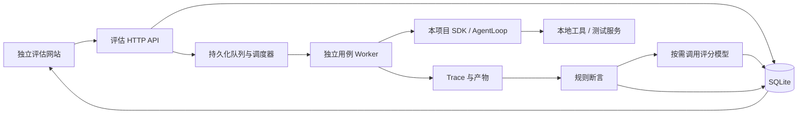

# Agent 自动化评估网站设计

## 1. 目标与边界

建立独立启动、独立访问的评估网站：维护测试任务，运行本项目真实 Agent，检查最终结果和执行过程，汇总成功率、回答质量、循环次数、工具调用、耗时与 Token。每一项结论都能返回对应断言、文件或 Trace。

第一版面向本项目开发者、本地单用户使用。支持手动发起批量评估、取消、历史报告与失败重跑。记忆和 Skill 可作为用例内容参与完整 Agent 评估，暂不单独建设记忆专项 benchmark。模型比较先以运行历史记录配置、查看不同报告实现，专门的对比分析页面后续扩展。

## 2. 方案比较

| 方案 | 优点 | 代价与适用范围 |
| --- | --- | --- |
| **独立网站 + 独立服务 + 本项目 SDK Worker（推荐）** | 自己启动；复用完整 Agent 链路；可隔离测试数据；易扩展后台能力 | 需要新增评估数据模型、调度器和 Trace 适配器 |
| 独立页面通过现有 Gateway 发起聊天 | 接口接入较少 | 测试状态易与日常会话耦合，难固定工作区、工具权限和完整执行证据 |
| 接入通用评估平台作为主体 | 可获得部分数据集和报表功能 | 仍需开发项目执行适配器，增加部署依赖，首版收益有限 |

选择第一种。同一仓库维护，单独前端入口、HTTP 服务和数据目录；运行评估不要求启动现有 WebUI 或聊天 Gateway。首版无需 Redis、Celery 或外部观测平台。

## 3. 已验证的代码基础

- `Nanobot.run()` / `run_streamed()` 经 `AgentLoop.process_direct()` 进入正常上下文与执行链。优先通过这一层适配，避免仅测试裸 `AgentRunner` 而漏掉上下文、Skill 和会话逻辑。
- `AgentHook` 暴露 run、iteration、工具执行前后与异常等生命周期，可采集参数、结果、错误和每轮状态。
- `AgentRunResult` 包含 messages、tools_used、usage、round_usages、stop_reason、error；SDK 返回值及流事件也已存在。
- `LLMUsage` 支持 provider 返回和本地估算，报告必须保留来源；循环轮数与实际模型请求数分别统计，避免把恢复重试混成一项。
- `Config.bind_source_path()` 与 `runtime_data_dir` 决定部分实例数据位置；只改 workspace 不能保证会话与日志隔离。
- 当前 `nanobot/utils/evaluator.py` 是后台通知门控，不承担任务质量判分。
- 现有 workspace restriction 是应用层保护；Windows 原生 shell 不能因此被视为操作系统沙箱。

以上是静态代码核对结果。Worker 的钩子覆盖、配置副作用与资源清理，仍须在实现测试中确认。

## 4. 架构与执行流程

1. 用户选择用例集、被测模型、评分模型和执行限制，点击“开始评估”。
2. 服务验证用例及配置；事务保存用例版本、规则、模型参数和运行快照，成功后返回 run_id。
3. 调度器从数据库领取待执行项。默认串行；并发可设 1–3，限制整个服务的总并发。
4. 每次用例执行启动独立 Python 进程，在专属目录准备文件、会话和记忆种子，通过 SDK 执行。
5. Worker 边执行边发送结构化事件；服务持续落盘，页面轮询进度。关闭浏览器不影响任务。
6. 执行结束后先做规则断言，再按用例配置做模型评分，合并结果并生成报告。
7. 失败重跑产生新运行，记录原 run_id 和 case_attempt_id；保留原报告。

HTTP 服务生命周期持有调度任务，停止服务时显式取消并等待清理。用例进程采用 asyncio subprocess；Windows 清理必须覆盖子进程树，沿用项目已有进程树管理方式并验证。

## 5. 网站页面

采用左侧窄导航、右侧内容区，优先显示表格、结果与证据。页面中不展示 API Key、原始配置文件或内部 Harness 术语。

| 页面 | 核心内容 | 主要操作 |
| --- | --- | --- |
| 评估概览 | 最近运行、最近一轮结果、通过/失败/待复核/异常分布、耗时与 Token | 新建评估、打开最近报告 |
| 用例集 | 集合与标签、用例版本、任务输入、文件种子、断言、评分标准 | 新建、编辑、复制、JSON 导入导出、停用 |
| 发起评估 | 用例选择、被测与评分模型预设、超时、最大循环、并发、工具模式 | 校验、开始运行 |
| 运行与报告 | 进度、状态计数、分项指标、用例结果表、配置快照 | 筛选失败、取消、失败重跑、导出 |
| 用例详情 | 原始任务、最终回答、规则检查、评分理由、执行时间线、文件产物 | 查看证据、添加人工复核结论 |

用例详情采用“结果 / Trace / 产物 / 配置”标签。Trace 按轮次折叠，展示模型可见请求摘要、工具名、参数、结果、错误和时间；长内容按需展开。只呈现接口实际返回的 reasoning，不推测或承诺获取模型内部思维过程。

首版使用约 1 秒轮询运行状态，Trace 按 cursor 分页增量读取。大文本截断需显示标记，并提供受权限控制的原文查看；状态不能只靠颜色表达。

## 6. 测试用例与版本

一个用例对应一个明确任务；支持单轮或一组有序 user turns。同一用例的多轮共享专属会话，不同用例共享状态被禁止。

| 字段组 | 内容 |
| --- | --- |
| 标识 | id、revision、name、description、tags、enabled、schema_version |
| 输入 | turns、受控 fixture 文件、可选记忆种子、固定时钟/测试服务引用 |
| 执行 | 最大循环、超时、工具模式与白名单、模型参数覆盖 |
| 判分 | 规则列表、规则是否必过、评分维度、通过阈值、是否必须模型评分 |
| 产物 | 需要检查的相对路径、允许保留的输出文件类型 |

规则至少覆盖：回答包含/不包含、完整 JSON 结构与指定字段、文件存在与内容、工具调用与参数匹配、禁止工具调用、最大循环/调用次数。JSON 结构检查通过固定声明式 schema 子集实现，首版不开放 Python、shell 或任意代码断言。

示例：“读取 fixture 中的 sales.csv，生成 summary.json，包含 total=42；必须读取输入文件，禁止网络请求”。成功以落盘 JSON 的结构和数值为准，回答中声称“已完成”不构成通过。

编辑用例形成新 revision；开始运行后即冻结快照。运行中修改用例不改变当次判分。首批准备 20 个基础用例，覆盖问答/结构化输出、文件读写、工具选择与参数、多步处理、失败恢复、会话上下文；稳定回归优先使用固定 fixture 与受控工具结果。依赖实时网络的用例打单独标签，不与固定样本混为同一基线。

## 7. 判分与报告口径

### 7.1 双层评估

规则检查负责客观约束；模型评分负责开放结果的任务完成、正确性、相关性/清晰度，以及需要语义判断的工具合理性。每个维度用 0–4 分的明确锚点描述，默认通过阈值 3；用例可以单独覆盖。

评分模型与被测模型分别配置，可以使用同一服务商，但单独记录。评分请求不挂载工具，不执行用例或 Trace 中的指令；只把它们作为待评材料。只接收经过结构校验的分数、理由、evidence_refs。证据引用必须指向实际存在的 Trace 或产物。

模型超时或输出格式错误时最多重试一次；仍失败标为 judge_error，保留已完成的规则结果。评分模型不能覆盖必过规则失败。评分提示词、量表版本和模型配置进入快照，便于复核。

### 7.2 状态分离

- execution_status：queued / running / succeeded / failed / timed_out / cancelled / interrupted / setup_error。
- grading_status：pending / running / completed / judge_error / not_applicable。
- verdict：passed / failed / review_required / not_evaluated。
- 必过规则失败或明确的执行失败 → failed；规则通过且必需评分通过 → passed；必需评分缺失 → review_required；取消、启动失败、服务中断等未形成可判结果 → not_evaluated。
- run_status：queued / running / cancelling / completed / cancelled / interrupted。completed 表示调度和评分均已结束，允许包含 failed、review_required 和 setup_error，页面同时显示各项计数。
- 人工复核单独记录 reviewer、结论、说明和时间；保留自动 verdict，不静默覆盖历史分数。

### 7.3 指标定义

| 指标 | 明确定义 |
| --- | --- |
| 全集通过率 | passed 数 / 该轮计划执行总数；取消、未执行与待复核不会提高这一比例 |
| 已评通过率 | passed / (passed + failed)，同时展示覆盖率与 review_required / not_evaluated 数 |
| 回答质量 | 有有效评分的维度均分，并列出评分覆盖数；缺失评分不填零 |
| 工具调用正确率 | 有明确工具判分标准且判分有效的用例中，通过工具规则的用例比例；总调用数与工具执行错误率另列 |
| 循环次数 | Runner iteration 数；重试与恢复中的模型请求数另计；按任务轮次汇总 |
| 耗时 | 排队、Agent 执行、评分分别计时；执行耗时展示中位数和 P95，注明有效样本数 |
| Token | Agent 与 Judge 分别显示 input/output/total、source；估算、实报和不可得分别标识 |

所有模型请求成本应覆盖重试与恢复；未能归集的调用标注缺失。Agent Loop 内部辅助模型调用与 Runner 主循环分别标记，禁止把只记录主循环的数值标成完整 Agent 总量。重试最终成功也保留次数与额外耗时。成本金额后续在取得可靠价格表后扩展，首版不推算费用。

## 8. 隔离与工具模式

每个 case_attempt 使用独立进程、会话、workspace、runtime data root；先设置该进程的配置路径上下文，再构造 SDK。不能直接以用户日常配置路径调用 `Nanobot.from_config()` 后仅覆盖 workspace。

专用 eval factory 复用 SDK/AgentLoop 的现有构造链，加载服务端选择的模型预设并在内存中形成执行配置。配置的 runtime root 绑定到 attempt 目录。模型凭据通过服务端受控配置或私有 IPC 注入，不进入数据库快照、子进程命令行、Trace 或导出文件。保留必要上下文/Skill/记忆逻辑；关闭消息投递、cron、自修改、自动 MCP 连接等外部副作用，工具白名单显式启用。

两种工具模式必须在页面与报告中明确标识：

- fixture：第一版默认。启用工作区内文件工具和受控测试工具；网络查询等返回固定 fixture。默认关闭原生 shell、真实 MCP 与外部写操作。这些用例用于验证调用决策和任务结果。
- live：可选启用实际网络只读工具，保留现有 SSRF 保护，报告标记外部依赖。原生 shell 与任意 MCP 不属于首版 live 白名单；将来支持时必须有可验证的沙箱策略。

fixture 回归结果不能宣称已经验证所有真实外部集成。对于基础用例中的“工具失败恢复”，由受控工具注入固定错误，以便复现。

fixture 文件、导入文件和产物路径全部做解析后的目录包含检查；拒绝绝对路径、目录穿越及指向外部的链接。产物只允许通过服务端生成的 id 读取，不直接接受任意文件路径。报告中的 HTML/Markdown 作为不可信内容转义显示。

网站默认绑定 `127.0.0.1:8790`，同源访问，禁止通配 CORS。启动生成本地登录口令，通过登录表单换取 HttpOnly/SameSite 会话；变更操作校验 Origin/CSRF。口令不放在访问 URL。局域网/公网发布和多用户权限属于后续范围。

## 9. 持久化与异常恢复

SQLite 保存 suite、case_revision、run、case_attempt、assertion_result、judge_result、manual_review 和 artifact 索引；Trace 以分段 JSONL 保存，每段有递增 seq 与 attempt_id。数据库仅保存摘要和文件索引，避免反复载入大日志。

默认评估数据放在 `.ai-runtime-artifacts/verifications/agent-evaluation/`：数据库、run 目录、attempt 工作区、Trace 与报告均在该目录。实现时加入精确忽略规则，避免运行数据被意外提交；示例用例定义作为产品源文件另行维护。所有本轮设计过程文档只写 `.ai-runtime-artifacts/`。

- 入队和领取使用事务；同一待执行项只能被领取一次。服务数据目录加独占锁，首版只允许一个服务实例。
- 用例超时或取消：停止评分与后续调度，回收 Worker 及其子进程，保存已收集 Trace 与原始错误。单个用例失败继续执行其余用例。
- 用户取消整轮时：待运行项直接 cancelled；运行项先进入取消流程，确认资源退出后结束，页面不能提前声称已停止。
- 服务重启：残留 running/cancelling 标为 interrupted；未完成的整轮不自动恢复，用户选择重跑，避免重复外部调用。
- 用例正常结束时，先原子完成 Trace/产物清单，再提交结果。写 Trace 失败视为证据采集错误，保留原始执行错误；证据不足不得给出 passed。
- 启动清理历史孤儿 Worker 前，验证 PID、启动标识和所属运行，禁止按名称批量终止进程。
- 用例和历史运行采用软删除；首版不自动递归清理工作区。导出 JSON/CSV 只包含脱敏摘要，下载文件走产物 id；CSV 文本需防公式注入。

## 10. 模块与接口边界

建议业务模块为 `nanobot/evaluation/`；独立前端为 `evalui/`。前端构建产物与现有 `nanobot/web/dist` 分开，避免构建覆盖。正式包需要显式包含评估前端资源，开发启动不依赖原有 Gateway。

| 模块 | 责任 |
| --- | --- |
| server / routes | 网站、登录、请求校验、分页、运行操作 |
| repository / schemas | SQLite 事务、版本、快照与声明式校验 |
| scheduler | 队列领取、服务级并发、状态流转与取消 |
| worker / runtime_factory | 构造隔离运行环境，调用 SDK，收集证据与清理 |
| trace | 统一事件、顺序编号、脱敏、持久化与分页 |
| graders | 确定性断言、无工具 Judge 请求、判分合并 |
| reports | 聚合指标、筛选与导出 |

拟新增启动入口 `nanobot eval serve`，默认端口 8790；这是拟实现命令，当前尚不存在。开发时独立前端启动并代理到该服务；构建后服务直接提供前端资源。

API 草案：`/api/eval/v1/suites`、`/cases`、`/profiles`、`/runs`；用 `POST /runs` 启动，`POST /runs/{id}/cancel` 取消，`POST /runs/{id}/rerun` 重跑；通过 `/attempts/{id}`、`/attempts/{id}/trace?after_seq=...`、`/artifacts/{id}` 和 `/runs/{id}/export` 查询证据与报告。列表统一 cursor + limit；错误返回 code/message/details/request_id；重复启动通过 Idempotency-Key 去重，非法状态返回冲突。

接口仍是设计草案。进入多模块实施计划前，按 Harness 要求加载 api-and-interface-design 并形成单独契约，明确完整字段、错误码和事件类型。

## 11. 验收标准

1. 可独立启动网站和服务；现有 WebUI/Gateway 未启动时仍可运行真实 Agent 用例。
2. 页面完整支持新建/编辑/复制/导入用例、启动评估、进度查看、取消、历史报告、失败重跑和证据查看。
3. 20 个基础用例能批量执行；每次尝试记录用例及评分规则版本、模型配置、Trace、分项判分、耗时与 Token 来源。
4. 注入规则失败、模型超时、Judge 格式错误、工具错误、采集错误、取消和服务重启，报告状态与原始原因准确；失败不被汇总或评分异常掩盖。
5. 两个用例在相同相对路径写入不同值，不会互读；会话、记忆和 runtime data root 均隔离；日常用户数据目录不产生评估写入。
6. 关闭页面不取消任务，重新打开可恢复进度；取消和超时后 Worker 及工具子进程无残留，Windows 必须验证。
7. 改用例不改变历史报告；失败重跑生成新运行；重复提交不会创建重复任务；第二服务实例被拒绝。
8. 所有断言通过、未判分、Judge 异常、执行失败等构造数据的聚合指标符合第 7 节公式；estimated 与 reported Token 在页面有区别。
9. 数据导入和产物下载拒绝越界路径；密钥不出现在 API、Trace、页面或导出；模型返回的 HTML 被安全显示。
10. 评分校准至少选取 10 个包含成功、失败和边界结果的人工标注样本；目标与人工通过/失败判断一致率 >=80%。未达标时显示校准不足，开放式任务默认进入人工复核，不将未校准结果用于门禁。

实现验证包含定向 pytest、ruff、strict basedpyright，独立前端的类型检查/构建/关键交互测试，以及浏览器走通完整评估流程。离线测试使用受控 provider；真实 provider 的冒烟测试单独标注配置和消耗，两者不混称。当前仅完成设计，不声称上述功能或测试已实现。

## 12. 设计自检与资料

- 确认需求与当前技术方案分开记录；用户在方案交付后回复“写计划”，本 spec 已批准，实施计划仍需单独审阅。
- 保持独立启动、完整 Agent 链路、运行与评分状态分离。
- 明确首版工具能力边界、Windows 隔离限制、失败口径与指标分母。
- 无实现代码、实施计划或工作单元派发；没有提交或推送。
- 代码事实来自本次静态读取，不采用 project.profile.md 中可能过时的分支/工作区状态。
- aiohttp 应用清理采用官方生命周期机制：https://docs.aiohttp.org/en/v3.9.5/web_advanced.html#cleanup-context
- 子进程与取消策略依据 Python 3.11 文档；进程树回收仍需项目级实现验证：https://docs.python.org/3.11/library/asyncio-subprocess.html
- SQLite 使用显式事务和连接生命周期：https://docs.python.org/3.11/library/sqlite3.html

## Next

本设计已获准进入计划阶段；实施计划见 plans 目录的 `2026-10-15-agent-evaluation-plan.md`，业务实现须等待计划门禁。

- 认可方案 → 说“写计划”或“制定实施计划”。
- 需要调整 → 直接说明修改意见。
- 希望直接进入实现准备 → 说“直接实现”或“直接做”；跨模块实现仍需补齐必要的接口契约与调度安排。
