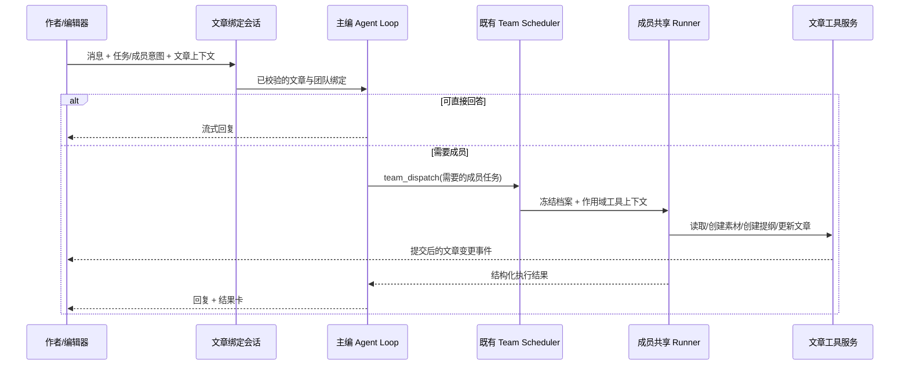

# 创作空间改版：文章主区与右侧团队对话

## 1. 产品定义与范围

创作空间是一张文章工作台：作者在中央写文章，在右侧与一个默认内置的创作团队持续对话。主编接收自然语言，需要时调用团队成员和文章工具；素材、提纲、正文是同一篇文章的持久内容。

**用户已明确选择：文章编辑为主，右侧固定对话。** 不采用对话全屏起步、文章按需才出现的默认布局。

本轮只交付调研和设计。本文若获确认，后续才能制定实施计划或编码。旧方案中与本轮需求冲突的固定流程设计不再作为新实现依据；已有保存、恢复、版本检查、内置资源保护和会话模型选择继续复用。

### 八项要求对应关系

| 编号 | 用户要求 | 本方案响应 |
| --- | --- | --- |
| U1 | 本质是对话，内置团队 | 右侧真实消息流，默认由创作团队主编接待；§3、§7 |
| U2 | 输入 `/` 或 `@` 唤起智能体干活 | `/` 选择任务并确定默认执行成员，`@` 点名成员；§4 |
| U3 | 团队专属的素材、提纲、文章更新工具 | 四个核心工具，按团队身份与文章会话注入；§6 |
| U4 | 团队管理默认种子数据 | 工作区初始化播种，管理页可见且显示内置来源；§8 |
| U5 | 不要当前工作流，用 Agent 循环组织 | 复用主编 Loop + team_dispatch + 共享 Runner；§7 |
| U6 | 编辑页划词提问、快速问 AI | 同篇对话的选区上下文，回答/修改两种意图；§5 |
| U7 | 侧边栏简化 | 右侧只留聊天，素材/提纲按需展开，导航管理项聚合；§3 |
| U8 | 开始时提供预设话术 | 右栏空态四个开场模板，填入输入框后发送；§9 |

### 成功标准

- 新工作区首次进入团队管理即可看到“创作团队”，无需先启动写作任务。
- 打开文章后可直接说需求，无需挑团队、配置流程或理解任务阶段。
- “解释这段”和“把这段改简洁”产生不同效果；只有明确的写入请求才修改内容。
- `/提纲`、`@结构编辑` 与自然语言都能进入同一个连续对话。
- Agent 确实通过工具保存素材、提纲、正文；消息中的“已更新”与持久化结果一致。
- 作者在 AI 执行期间继续写作，不会被晚到结果覆盖；修改可对比和撤销。
- 右栏在空闲时只显示消息/开场话术和输入框，不显示流程启动、阶段、原始事件序号。

## 2. 调研结论与路线选择

推荐“文章主区 + 右侧团队对话 + 文章作用域工具”。另外两条路线分别是只把旧任务面板改成气泡，以及以全屏聊天为默认入口；前者保留了根本问题，后者不符合用户已确认的布局。

Notion 将 Agent 对话、选区编辑、空白起草放在同一文档体验中；Lex 支持围绕草稿聊天及选段提问。它们支持对话与局部编辑共存的交互方向。[Notion 官方指南](https://www.notion.com/help/guides/notion-ai-for-docs)、[Lex 一手说明](https://buttondown.com/lex/archive/announcing-lex-for-teams/)。

命令入口与选区上下文可以缩短请求表达；VS Code 的官方文档提供了 `/` 命令和局部编辑接续既有对话的参考。本项目据此设计自己的写作任务与成员路由，不引入代码产品中的终端或权限配置界面。[VS Code 聊天](https://code.visualstudio.com/docs/chat/chat-overview)、[内联交互](https://code.visualstudio.com/docs/chat/inline-chat)。

本地核对详见配套调研：现有团队 Loop、文章仓储、恢复缓存可以复用；`writing.reply` 仍是动作批次，选区未接入，成员 `@` 与写作工具也尚未具备完整执行链。

## 3. 页面与信息层级

### 3.1 默认桌面布局

```text
┌──────┬─────────────────────────────────┬───────────────────────┐
│ 助手 │ ← 文章列表   Redis 的原理        │ 创作团队   内置   ··· │
│ 创作 │ 已保存     素材 3  提纲 6  导出  │                       │
│ 更多 ├─────────────────────────────────┤ 你：先帮我找三个角度  │
│      │ 编辑  预览  分屏                │ 主编：可以从……        │
│      │                                 │                       │
│      │             正文编辑            │ 结构编辑 · 提纲卡      │
│      │                                 │ 查看提纲               │
│      │  选中一段 → 问 AI / 改写 / …    │                       │
│      │                                 ├───────────────────────┤
│ 设置 │                                 │ 已引用：选中文本 ×     │
│      │                                 │ 输入需求，/任务 @成员 │
│      │                                 │ 模型       停止/发送  │
└──────┴─────────────────────────────────┴───────────────────────┘
```

- 文章始终是主区；右侧桌面默认常驻，初始宽度约 380px，允许在 340–480px 间拖动并记忆。
- 工具栏只保留文章标题、保存状态、素材、提纲、导出与更多。没有第二层重复的“创作空间”标题占位条。
- 素材/提纲改成带数量的入口，点击后打开主区内的抽屉或面板；默认关闭，退出后还原编辑宽度。
- 原有编辑、预览、分屏保留；分屏指 Markdown 编辑/预览，不与右侧团队对话混为同一个切换。
- 右栏可临时收起以便专注，展开回同一会话，默认仍常驻；没有任务运行时也能输入。
- 在 1280px 宽度下正文编辑区至少保留约 640px。宽度不足时缩小右栏或改抽屉，不强塞三列。
- 小屏以“文章 / 对话”切换或右侧全屏抽屉呈现，同一会话与文章状态不丢失。

### 3.2 右侧对话仅保留三层

1. 顶栏：“创作团队”、内置标识、折叠/更多；成员列表、团队管理与执行详情放进更多。
2. 消息时间线：用户请求、主编回复、带角色标记的成员结果、轻量工具回执/产物卡。
3. 固定输入框：可移除的引用、`/` / `@` 提示、模型控件、发送/停止。

执行中在当前回复显示一条可折叠的活动，例如“研究员正在查找资料”。展开可看工具名称、成员和状态；默认不把团队所有内部消息逐条刷进作者对话，也不展示推理正文。

“启动完整流程”、固定任务矩阵、阶段摘要、空的返回结果区、常驻协作过程区全部退出默认右栏。错误归属到失败的消息或工具卡，提供对应的重试，不用一条全局红条长期占位。

### 3.3 全局侧栏收敛

一级导航保留“助手”“创作”“更多”，底部保留设置。应用、技能、定时、智能体、团队、记忆、身份进入“更多”分组菜单；其中智能体/团队归“AI 配置”，其他项按现有用途分组。

只调整入口层级，沿用现有路由和功能页面。用户从旧深链进入团队或记忆时，更多入口显示当前页面状态；团队管理最多两次点击可达。不得顺手删除管理能力或另建一套设置页面。

## 4. 对话输入与 `/`、`@` 语义

### 4.1 普通输入

自然语言默认发给主编，例如“这篇面向初学者，先给三个选题角度”。主编可以直接回答、询问一个必要问题、调用读取工具、派一个成员任务或组合多个必要任务。

用户无须先按某个启动按钮。缺读者/字数时，只要不影响当前请求就先采用合理假设并说明；不在开始写作前强制填写表单。

### 4.2 `/` 表示做什么，并提供执行成员

在输入开头键入 `/` 打开当前创作空间的菜单，首屏列出：

| 命令 | 菜单中文说明 | 默认处理者 | 选择后的行为 |
| --- | --- | --- | --- |
| `/构思` | 找选题角度 | 主编 | 填入可编辑的构思请求 |
| `/素材` | 查资料并整理素材 | 研究员 | 填入任务和成员标记 |
| `/提纲` | 创建或调整提纲 | 结构编辑 | 填入提纲请求 |
| `/写作` | 写正文或续写 | 写手 | 填入章节/正文请求 |
| `/改写` | 修改选中内容 | 写手 | 有选区则附带引用；无选区则提示指定段落 |
| `/审校` | 检查事实与表达 | 审校 | 填入检查请求；默认只提建议 |

支持 `/research`、`/outline`、`/draft`、`/rewrite`、`/review` 等英文检索别名，但展示以中文任务为主。菜单还可列“团队成员”，选择后插入相应成员标记。

选择菜单只填入输入框，不立即发请求；按发送才执行。快捷任务最终是消息的结构化意图和技能提示，不映射回旧 `start_full`、不预先固定多阶段任务。

保留已有模型切换和停止能力。全局管理命令无需占满写作任务首屏。普通正文中的 URL、路径或非命令位置的 `/` 不弹菜单。

### 4.3 `@` 表示谁来做

在输入框开始或空白后输入 `@`，优先展示本团队：主编、研究员、结构编辑、写手、审校。选择后形成可删除的成员标记，保存稳定的 member ID，不靠中文姓名字符串做权限判断。

例如：`@研究员 补充三个来自 Redis 官方文档的例子，存到素材里。`

- 仍使用本篇同一个会话，由主编路由给被点名成员；回复和回执标注真实执行成员。
- 明确点名后，本次请求默认交给该成员；成员不能胜任时主编说明原因，不无提示地换人。
- 首版每条消息最多一个执行成员；需要多人协作可以直接描述，交由主编派工。再次选成员替换原标记。
- `@` 下方另设“文章内容”分组：全文、当前选区、提纲、已选素材。上下文引用与执行成员有不同图标和字段，避免混淆。
- 创作输入框不默认罗列全部 CLI、MCP 和全局智能体。普通聊天维持已有提及行为。
- 纯文本中的邮箱或被粘贴的 `@名字` 不直接授予成员路由身份；有效路由依赖菜单选择的 ID 或服务端识别的受限别名。

### 4.4 运行中输入、键盘与可访问性

输入框在运行中可继续编辑；发送的新消息默认排队，下一个回合开始前重新准备文章上下文。停止按钮取消当前主编回合及其成员任务。首版不承诺在成员工具执行中即时插入新指令。

Enter 发送，Shift+Enter 换行；中文输入法 composition 期间 Enter 不发送、`/` / `@` 不抢按键。菜单支持方向键、Enter 选择、Esc 关闭。输入框固定，消息流单独滚动；作者向上阅读时不被流式消息强制拉到底部。

## 5. 划词提问与快速问 AI

### 5.1 作者操作

在编辑模式选中一段文字，出现轻量操作条：“问 AI”“改写”“扩写”“精简”“更多”。

- “问 AI”：右侧输入框附上选区引用并聚焦，由作者继续提问；不立即修改文章。
- “改写/扩写/精简”：填入对应的可编辑请求与选区，发送后执行。
- “更多”：解释、核实、换一种语气等低频操作。
- 对当前小节也可从提纲项菜单选择“问 AI”，携带对应小节标识和标题；无法可靠定位正文时，只能按标题提问，不自动改写。
- 桌面快捷键可用 `Cmd/Ctrl+I` 唤起当前选区提问；与宿主快捷键冲突时保留菜单和按钮路径。

操作条应靠近选区且不遮挡文本。第一版基于原生 textarea 实现；若无法稳定获取精确字形坐标，则显示在编辑区内固定的轻量选区工具条，行为保持一致，不因此替换整个编辑器。[选区 API](https://developer.mozilla.org/en-US/docs/Web/API/HTMLTextAreaElement/selectionStart)。

### 5.2 引用和定位

选区快照包含文章 ID、base revision、正文摘要、原文、起止位置，以及相邻文本定位信息。点击操作条前先捕获，输入框获得焦点后引用仍保留；切换文章自动清除尚未发送的旧文章引用。

前端 DOM 位置以 UTF-16 计数，服务端继续使用 Python 码点。复用 `utf16RangeToCodepoints()` 和现有 offsets 校验；包含 emoji、组合字符、重复句子、CRLF 的内容都必须测试。[HTML 文本选区标准](https://html.spec.whatwg.org/multipage/form-control-infrastructure.html#textFieldSelection)。

首版只对 Markdown 编辑区提供可写选区；预览模式可提供全文提问入口，不把渲染 DOM 偏移直接当作 Markdown 源码偏移。

### 5.3 示例行为

| 请求 | 结果 |
| --- | --- |
| “这段是什么意思？” | 对话回答，不调用写工具 |
| “这段说法准确吗？” | 查证与解释，必要时创建用户要求保留的素材，不改正文 |
| “给这段提供三个开头” | 消息中返回备选，点击采用后才写入 |
| “把这段改简洁，保留术语” | 更新该选区，展示对比与撤销 |
| “把第二节按这个提纲重写” | 可靠定位并核对版本后写入；定位不清则询问范围 |

## 6. 团队专属工具

### 6.1 核心工具与真实落文

以下是拟议的工具语义，不代表接口已经实现或冻结。工具不让模型自由指定 workspace、任意文章 ID 或会话 ID；这些来自可信运行上下文。

| 工具 | 主要输入 | 结果 | 有权调用的角色 |
| --- | --- | --- | --- |
| `writing_read_article` | scope：全文/选区/提纲/素材；可选素材 ID | 当前持久快照、revision、digest、相关上下文 | 全部创作成员 |
| `writing_create_material` | title、type、content、url/source、note、幂等键 | 写入素材并返回 material ID、新 revision | 主编、研究员 |
| `writing_create_outline` | 按顺序的提纲项、创建/替换意图、expected revision | 写入提纲并返回 outline IDs、新 revision | 主编、结构编辑 |
| `writing_update_article` | 操作类型、定位、before/after、expected revision、幂等键 | 写入正文/标题，返回变更 ID、新 revision、摘要 | 主编、写手 |

首版提纲复用现有平铺 `{id,text,order}` 模型；素材复用 `type/title/content/url/source/note/included` 等字段。层级提纲、富文本结构和媒体资产库另行设计，不在本轮顺手扩展。

`writing_update_article` 只允许追加、插入、精确范围替换、明确的全文替换及标题更新；不允许删除文章或任意修改系统元数据。审校默认只读，在对话中给出问题与建议；作者点击采用后由受控写入路径执行。

### 6.2 什么时候直接写入

- “整理进素材”“创建提纲”“写进正文”“替换这段”等明确写入指令，允许工具直接执行，完成后提供“查看修改 / 撤销”。不在每一步增加确认弹窗。
- 单纯解释、讨论、比较方案和审校只回答或给建议。作者选择“采用”是新的写入意图。
- 已有提纲时仅说“给几个提纲思路”，先返回备选；说“把提纲改成五节”才替换现有提纲。
- 全文替换必须有清晰的范围指令；“优化一下”且没有选区时先说明建议范围或问一个必要问题。
- 模型只能提出操作参数；服务端依据本次用户意图、角色权限、文章版本、运行有效性决定是否执行，不能只相信模型传来的 `write=true`。

### 6.3 专属范围是执行约束

要同时满足：可信内置团队身份、允许的成员、绑定文章的创作会话、有效 turn/run、对应写入权限。只配置了同名 Agent、克隆团队、在普通聊天中输入“writing-team”，均不能获取写作工具。

工具类不加入通用自动发现目录；参考 `TeamDispatchTool._plugin_discoverable=False` 的宿主注入方式。作用域工具目录先参与团队档案冻结和白名单解析，随后在 Leader/成员的独立 registry 中实例化。

当前 `build_leader_registry()` 只能从 base 取工具，`SubagentManager._build_tools()` 会重新加载工具。因此需增加一个小范围的、可信宿主提供的工具工厂/运行上下文扩展点，同时覆盖 Leader 与成员；仅把名称写进 allowlist 不够。不得临时改全局 registry 后再恢复，也不得在执行时按未冻结的 Agent 档案重新取权限。

创作工具上下文随调度任务传播，并在结束时释放。保留通用聊天既有工具集合，防止两个并发会话互相看到对方的文章工具。

### 6.4 写入、冲突与撤销

所有写操作经过文章应用服务，复用仓储的字段校验、CAS 与摘要逻辑。工具回执只有在事务提交后才能显示“已创建/已更新”。事件携带文章 ID、会话/turn ID、变更 ID、revision 和可展示摘要。

每个变更记录受影响字段的 before/after、执行成员、来源消息、请求指纹与结果版本。文章内容、幂等结果、变更/撤销记录同事务提交；同一请求同载荷返回原结果，同键异载荷拒绝。不能直接沿用裸 `INSERT OR REPLACE` 覆盖请求记录。

现有撤销数据只覆盖正文，不能宣称已支持素材/提纲撤销。本轮改版必须补齐上述工具修改范围的撤销数据；可采用受影响字段快照，避免为每种字段建立独立机制。

撤销仅在当前 revision/digest 仍匹配该变更结果时直接还原。之后若已有作者或其他 Agent 修改，则保留最新内容并显示可比较的恢复建议，不能用旧快照覆盖后续编辑。

## 7. 运行架构：以现有 Agent Loop 组织协作

### 7.1 主路径



`AgentLoop / AgentRunner` 负责模型推理和工具循环；`TeamLeaderTurns` 提供团队回合，`team_dispatch` 派发，`TeamMemberExecutor.execute_member()` 经 `execute_frozen()` 执行成员。保留通用任务限额、取消、失败处理与事件投影。

主编根据当前请求决定是否需要团队、哪些成员、是否继续。提示词可以建议先理解目标、必要时检索、检查事实，但不能把每条消息硬编码成“研究→提纲→初稿→审校”。例如只改一句不启动研究员，只问概念不创建文章任务。

通用 Scheduler 可以表达依赖任务；本方案去除的是创作空间固定配方驱动的业务控制层，不删除通用依赖、运行状态和限额。

### 7.2 文章与会话关系

首版每篇文章有一个默认团队对话，会话由服务端创建/查回并绑定到文章及其所属工作区。客户端不能用拼接 `${articleId}:partner` 替代真实归属校验。

复用现有消息持久化、流式事件、历史分页和重连机制；文章实体仍在 WritingRepository，聊天记录仍在 Session，不再为同样的自然语言另建一套历史。消息中的产物卡通过 artifact/change ID 引用持久结果。

存量协作会话只有通过服务端校验绑定后才可复用。旧流程产物显示为“历史协作记录”，不伪造为当时发生过的用户/助手对话。

### 7.3 上下文与模型

每个回合准备：用户本次消息、适量历史、文章标题/读者/风格、当前提纲、选区及周边、明确引用的素材。长正文和大素材按需用读取工具获取，不每次把所有资料塞进提示词。

回合开始前冲刷自动保存，取得服务端确认的 revision/digest；离线或保存冲突时仍可提问，但写工具禁用并解释原因。不能给 Agent 一份未保存正文，又让它针对旧服务端正文落文。

模型选择复用已有会话 `model_preset` 和显示控件，实际执行与显示来自同一来源。团队成员默认继承该会话模型，不另建一组硬编码模型配置。沿用已有模型失效处理口径，任何回退须与 UI 展示一致。

### 7.4 人机并发与写入门禁

作者可以在模型运行时继续编辑。写工具在提交前请求编辑器完成当前保存；编辑器若正处于 IME、脏稿冲突或离线，暂不提交 AI 修改，结果转为可采纳建议卡。该握手有超时，页面关闭或未回应时也退为建议，不使工具永久等待。

握手成功后只接受精确的 expected revision/digest。并发变化导致 CAS 失败时，Agent 读取新版本并判断能否在原意图范围内重新定位；首版最多自动重试一次，仍冲突则返回建议。作者在握手之后新输入的内容仍按现有保存冲突机制保留，UI 不用服务端快照直接覆盖本地脏稿。

成员可并行检索，但同篇文章写操作串行进入应用服务。任务取消后检查有效 run/turn，拒绝晚到写入；取消不撤回已经提交的修改，作者可通过撤销处理。

### 7.5 传输边界

拟增加或复用的业务能力是“取得/建立文章绑定对话”，返回真实 session/team binding；随后发消息走已有聊天通道。`/` 意图、成员标记、选区引用作为结构化消息元数据，服务端校验其类型和范围。

文章变更沿既有认证 WebSocket 广播，断线后按序号/版本补拉快照。HTTP 继续读，mutation 继续走认证 WS；不为了本功能单独创建匿名模型调用接口。具体动作名、字段、错误码和握手超时值在方案确认后的接口契约中冻结。

## 8. 团队种子与管理

### 8.1 固定默认团队

复用现有逻辑 ID `writing-team` 与五个 Agent：

| 角色 | 职责 | 常用技能 |
| --- | --- | --- |
| 主编 `writing-editor` | 理解目标、连续对话、派工、总结、必要的小范围修改 | brief、review |
| 研究员 `writing-researcher` | 查证、整理来源、创建素材 | research |
| 结构编辑 `writing-architect` | 组织结构、创建和调整提纲 | outline |
| 写手 `writing-author` | 写初稿、续写、局部改写、更新正文 | draft、rewrite、expand |
| 审校 `writing-reviewer` | 事实/逻辑/表达检查，给出定位建议 | review |

复用已有 article-* Skill，调整主编与成员提示词，去除固定阶段要求和强制 envelope 文本交付依赖。真实修改从工具返回，不能靠解析模型最终回复猜测它是否已写入。

### 8.2 播种、版本与来源

- 在工作区服务初始化时幂等播种，顺序是内置 Skill/Agent 依赖就绪、作用域工具目录可解析，再建立团队。
- 复用 `BuiltinAssetRegistry` 与 `TeamService.ensure_builtin_team()`。不能继续只在 `TeamWritingPort.resolve_team()` 首次运行时惰性创建。
- 模型未配置仍能看见内置团队和成员，使用时引导已有模型设置；播种不应依赖 API Key 可用或实际模型请求。
- 团队管理的列表和详情投影 `origin=builtin`、`ownerModule=writing`、builtin version 与保护状态；这些从服务端登记表获得，不信任客户端声明。
- 显示“创作空间内置”和“默认用于创作空间”。内置模板只读、禁止删除/归档/覆盖，可查看详情及复制为自定义团队。
- 克隆可保存成员配置，但不会继承文章工具的执行资格；普通聊天选择该克隆也不能改写创作空间文章。
- 保留现有逻辑 ID 冲突避让。重启不重复创建，模板内容没变化不增加 revision，升级只修改已登记的内置资源，不覆盖同名用户团队。
- 登记表当前以 builtin version 参与查找，升级时须先迁移已登记的 physical ID 映射并刷新同一团队，不能简单切版本后再次分配团队，造成重复种子。
- 每个运行冻结团队版本；已有文章会话保持其绑定版本，新文章使用最新内置版本。旧会话在无任务运行时提供“更新内置团队”操作，由服务端验证迁移；不悄悄改运行中的成员和权限。

## 9. 开场话术

对话空态使用一句欢迎语：“我是你的创作主编，可以帮你查资料、搭结构、写正文和改表达。” 下方显示四个完整表达的示例，点击后填入输入框，不自动发送：

| 场景 | 预设表达 |
| --- | --- |
| 有主题，未开始 | “我想写一篇关于【主题】的文章，面向【读者】。先帮我找三个值得展开的角度。” |
| 有材料 | “根据我选中的素材，帮我整理核心观点，并创建一份文章提纲。” |
| 已有提纲 | “按照当前提纲写一个初稿，表达自然，保留资料出处，不确定的地方标出来。” |
| 已有正文 | “帮我审阅这篇文章，重点看逻辑、重复表达和缺少证据的地方，先给修改建议。” |

根据文章状态调整顺序；空文章优先构思/素材，已有提纲优先初稿，已有正文优先审校/改写。选区存在时优先出现“解释这段”“把这段说清楚”。有历史消息后收起大块开场卡，只在输入框 `/` 菜单保留入口。

占位符必须由作者补充或根据文章标题明确填入；不能把含【主题】的原模板直接提交，也不能在第一轮自动触发写作全流程。

## 10. 对现有代码的处理边界

| 区域 | 保留复用 | 改造重点 |
| --- | --- | --- |
| `creative/ArticleEditor`、保存 flow | Markdown、预览、分屏、IME、恢复、保存和冲突处理 | 添加选区与写入握手；收敛素材/提纲入口 |
| `creative/CreativeWorkspace` | 文章列表、文章身份、模型配置来源 | 建立真实绑定会话，协调文章变更和右侧消息 |
| `creative/WritingPartnerPanel` | 可复用模型控件和已有产物展示片段 | 替换任务面板结构，接入聊天时间线和输入框 |
| `thread/ThreadComposer` 等聊天基础组件 | 消息展示、流式、命令、键盘和停止模式 | 以注入目录/插槽扩写作任务和成员候选，避免复制整套聊天 |
| `teams/turn`、scheduler、execution | 团队冻结、派工、共享 Runner、限额、事件 | 扩展可信写作运行上下文与工具工厂 |
| `writing/repository`、`collab/apply` 等 | 数据校验、版本/摘要、事务和建议 | 提取可复用写入服务，补全字段撤销与严格幂等 |
| `writing/collab/recipe` 与固定推进 | 旧历史的读取能力 | 新请求不再依赖固定动作配方、自动阶段交接 |
| `writing/builtin`、TeamService、TeamsView | 资产身份、保护、版本管理 | 接初始化播种与内置来源展示 |
| `WorkspaceNavigation` | 所有功能路由 | 一级入口聚合为助手、创作、更多与设置 |

不新增多 Agent 框架或工作流引擎。首版不重写全文编辑器，不建设用户可编辑工作流画布，不做自动发布、批量写作、图片/视频素材系统。

### 存量兼容

旧文章内容、素材、提纲、版本和协作产物保留。切换新入口前停止接受旧配方的新运行；已有活动任务自然结束或由作者停止后再使用新路径，同篇不能同时由新旧入口写入。历史只读展示不触发重放，也不要求删除旧库表。

## 11. 验收场景

| 编号 | 场景 | 可观察的通过标准 |
| --- | --- | --- |
| A01 | 新工作区直接开团队管理 | 已有唯一创作团队及五个角色，重启无重复 |
| A02 | 已有同名用户团队后升级 | 用户团队内容不变，内置团队能避让并显示正确来源 |
| A03 | 打开空文章 | 中央可编辑，右侧固定聊天和四条开场话术，无流程按钮 |
| A04 | 输入普通问题再连续追问 | 历史可回看，主编记住本篇上下文，不自动启动固定多阶段任务 |
| A05 | `/提纲` 与 `@结构编辑` | 菜单可键盘操作，发送后使用正确成员，选中菜单本身不运行 |
| A06 | `@研究员` 查证并保存素材 | 真实素材 ID 与持久化内容一致，有来源、工具回执和撤销 |
| A07 | 创建/调整提纲 | 提纲面板实时更新，旧内容可恢复，不重复写入 |
| A08 | 选中含 emoji 的文字提问 | 引用范围正确，正文完全不变，回答进入同一对话 |
| A09 | 对选区发出明确精简指令 | 只改目标区，查看对比/撤销有效，周边文字不变 |
| A10 | 生成三个备选或请求审校 | 先显示建议，未经采用不修改正文 |
| A11 | AI 运行中作者继续输入/使用 IME | 本地稿不被覆盖；握手失败/超时产生建议卡；冲突可恢复 |
| A12 | 工具超时、停止、断线重连 | 无重复落文；晚到写入被拒；已提交修改可在重连后查回 |
| A13 | 普通聊天、自建/克隆团队调用写作工具 | 工具不暴露或执行被拒，不能靠伪造文章 ID/成员名绕过 |
| A14 | 切换文章与恶意旧引用 | 不串会话、不串选区，不读取其他文章的私有上下文 |
| A15 | 模型切换与团队版本更新 | 展示与实际执行一致；在途运行不被新配置影响 |
| A16 | 1280/1440 桌面与小屏 | 桌面正文主区清晰、右侧聊天常驻；小屏不溢出，功能可达 |
| A17 | 全局侧栏收敛 | 更多中的全部原功能可达，旧深链仍正确，团队管理两次点击内可达 |
| A18 | 素材/提纲/正文撤销后又继续编辑 | 不回滚后续作者修改；版本不匹配则展示恢复建议 |

实施验证需包含工具服务/CAS/幂等/取消测试、团队工具隔离测试、聊天与编辑器组件测试，以及真实模型的“查素材→提纲→局部修改”冒烟。真实模型未跑通时必须记录具体缺口，不能仅靠 mock 宣称整体可用。

现有检查命令仍按 `harness-kit/project.verification.md` 执行：对应 pytest、Ruff、BasedPyright，以及前端测试、lint、构建。本轮只有文档，不以运行无关业务测试代替方案核对。

## 12. 风险、取舍与评审状态

- 最大技术风险是并发编辑与工具写入，必须通过保存握手、精确版本、事务和失败转建议共同解决；不能只靠“让模型少改一点”的提示词。
- 第二个风险是工具可用目录与实际 registry 不一致，必须验证 Leader 和成员两条路径以及普通聊天隔离。
- 现有团队默认播种与字段撤销只有部分底座，均计入本次改版范围，不能按“已经有函数”视为完成。
- 提纲保持当前平铺结构，换取较小数据迁移成本；预览模式暂不支持定位改写，换取明确的源文范围。
- 新请求采用 Agent 自主派工，质量依赖提示词与工具结果；先覆盖知识/博客/公众号文章，不承诺所有体裁质量。
- 布局选择已由用户确认；直接写入的意图规则、导航聚合与种子保护策略是本文提出的产品决策，仍随整体方案接受评审。

### Spec 自检

- U1–U8 均有设计位置与可观察的验收场景。
- 已消除“全屏对话默认”与用户“文章主区、右侧固定对话”的冲突。
- 区分了当前代码事实、外部产品事实和本项目提议，没有把拟议工具称为已实现。
- 已明确问答/备选/修改的落文规则、选区模式边界、取消与撤销语义。
- 已明确没有新的模型调用循环，也没有把旧固定配方仅改名为聊天。
- 接口签名、错误码与并发接口的细化属于后续契约与实施计划，本轮没有派发实现任务。

## Next

- 认可方案方向 → 说“写计划”或“制定实施计划”，再冻结会话绑定、工具上下文、保存握手与事件接口。
- 希望调整交互或范围 → 直接指出章节或具体行为。
- 若要求“直接实现” → 按项目门禁先补齐此跨模块任务所需的实施计划与接口契约，再进入编码。

本轮止于方案文档，不修改业务代码、不启动任务、不自动提交或推送。
