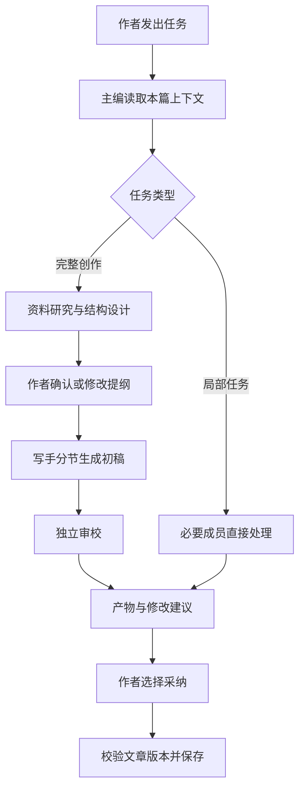

# 创作空间：侧栏内置创作团队

## 1. 目标与已确认边界

写手打开文章即可使用一套产品预先设计好的创作团队。主编理解本篇文章的目标，自动协调资料研究、结构设计、写作与审校，产出能审阅和采纳的内容。作者无需创建团队、选择成员、绑定 Skill、配置节点或理解 MCP。

主场景为公众号、博客和知识类文章。用户的最新要求为：“设计一套固定的团队，然后应用到创作空间的侧边栏……不需要用户指定团队”。这一要求替代此前对“可配置工作流”的理解。

内置资源由产品提供，在 Agent、Skill 和适用的 MCP/团队管理页明确显示“创作空间内置”，保护删除入口。通用聊天、用户自建团队及现有管理功能继续沿各自约定运行。

### 成功标准

- 复用已经配置的模型，打开文章后无需新增配置即可开始协作。
- 用一句“帮我完成这篇文章”启动，团队能给出目标梳理、可核对资料、提纲、初稿与审稿建议，并在必要交接点等待作者。
- 作者可只让团队补资料、改一段或审全文，避免每次都执行整条链。
- 真实角色、实际 Skill、使用的资料和模型可以追溯；模型不可用时明确失败。
- AI 产物先进入建议区，作者采纳后通过服务端版本检查写入文章。
- 内置标识与不可删除由服务端保证，直接请求删除、同名导入和覆盖不能绕过。

### 不进入本次范围

用户可编辑工作流、Dify 式画布、团队选择器、节点/角色配置向导、小说设定管理、自动发布、批量生成与定时写作。首版不新增账号要求和技术依赖。

## 2. 依据与方案选择

现有文章库、素材、提纲、自动保存与恢复可以复用；`ArticleEditor.tsx:413` 的 AI 区仍为占位。旧 Phase B 计划为草稿，其字符串式 `run_inline` 设计需要结合后来落地的 Team 执行重新评估，不能直接照搬。

产品参考：Lex 的[文档内审阅](https://lex.page/read/c563b895-d226-40c6-988f-33add2ff1dac)支持把建议放回作者的编辑过程；Novelcrafter 的[上下文选择](https://www.novelcrafter.com/help/docs/codex/codex-tracking)提示本次资料范围应明确；[STORM 上游](https://github.com/stanford-oval/storm/blob/main/README.md)支持资料、提纲、正文分阶段组织的参考。它们是设计输入，本项目不承诺同等生成效果。

| 路径 | 评价 |
| --- | --- |
| 侧栏固定创作团队，主编自动派工 | 采用；符合用户直接使用的要求，复用已有 Team |
| 每个按钮独立调用一个提示词 | 能做局部帮助，但缺少目标共享、资料传递和审稿闭环，不作为最终方案 |
| 用户选团队、配置流程或节点 | 用户明确排除，不建设相关配置入口 |

## 3. 作者看到的侧栏

替换文章编辑器当前的“AI 建议”占位区，侧栏标题为“创作搭档”，附简洁的“内置团队”标识。

默认内容依次为：本篇目标摘要、主操作“帮我完成这篇文章”、快捷任务、对主编的输入框、当前任务进度、待作者处理的产物。作者可随时写“这里太空泛，补个真实例子”或“保留我的语气，缩短三分之一”。

| 入口 | 所需上下文 | 团队交付 |
| --- | --- | --- |
| 帮我构思 | 文章主题；可选目标/读者 | 选题角度、读者问题、主张与差异点，供作者选择 |
| 找资料 | 主题或选中论点，勾选素材 | 带出处的资料卡、待核实问题、支持与反对证据 |
| 列提纲 | 目标、素材、已有正文 | 层级提纲，每节要回答的问题及可用素材 |
| 写初稿 | 已确认提纲，或已有正文对应章节 | 分节初稿建议；缺少必要提纲时先给提纲 |
| 改这段 | 非空选区、周边段落、作者要求 | 局部改写及修改理由；无选区时提示选择范围 |
| 审全文 | 非空正文及其来源 | 事实、结构、可读性问题与定位明确的修改建议 |

“帮我完成这篇文章”按现有内容接续，已有提纲/正文不强制从选题重来。进度显示“正在查资料”“结构编辑已完成提纲”“等你确认提纲”等作者可理解的状态；展开详情才展示实际成员、工具和用量。

窄屏以可收起面板呈现；切换面板、关闭侧栏不会停止任务。保留键盘操作、现有 IME 与未保存提醒，不因流式输出抢走正文焦点。

## 4. 固定团队与专属 Skill

团队产品逻辑 ID 为 `writing-team`，产品名“创作团队”；由服务端映射到当前工作区的内置定义，不要求客户端传 `teamId`，不绑定或更改通用聊天的默认团队。下表同样是产品逻辑 ID，实际存储 ID 与同名用户资源的冲突处理见 §13.1。

| Agent 产品逻辑 ID | 作者可见角色 | 职责 | 配套 Skill |
| --- | --- | --- | --- |
| `writing-editor` | 主编 | 理解目标、拆任务、选择必要成员、检查交付、总结下一步 | `article-brief`、`article-review` |
| `writing-researcher` | 资料研究员 | 读取指定素材、检索与核对来源、标注疑点 | `article-research` |
| `writing-architect` | 结构编辑 | 组织主张、论证链、段落与例子，形成提纲 | `article-outline` |
| `writing-author` | 写手 | 根据确认内容分节写作、续写、局部改写，保留作者表达 | `article-draft`、`article-rewrite`、`article-expand` |
| `writing-reviewer` | 审校 | 独立检查事实、结构、重复、可读性，输出问题与补丁 | `article-review` |

固定团队不等于每次启动全部成员：改写一段默认只调用写手；审全文调用审校，必要时让研究员核对事实；完整创作才由主编分阶段协调。写手完成的初稿不能直接充当独立审校结果。

Skill 正文必须包含用途、输入、步骤、产物格式、边界和失败处理，并实际加载到本次执行中。正文摘要或一个技能名称不算已使用。执行记录保存来源、版本与正文摘要哈希。

模型沿用当前可用的全局配置，不硬编码供应商或型号；没有写作专属 preset 也能运行。失效的显式 preset 明确报错，不以默认模型假装执行了原配置。

## 5. 内置的协作流程



这是团队内部固定执行规则，界面不提供流程编辑器。主编可在角色白名单内决定补充哪项研究，不可增加新成员、扩大工具权限或无限返工。

1. 发起前先通过现有保存队列获得服务端文章快照；冲突/离线时保留输入并明确阻止使用伪造的“已保存版本”。
2. 冻结本次目标、正文、选区、勾选素材、团队与 Skill 版本。只传递本次明确可用资料。
3. 空白文章先形成角度/提纲；完整创作在提纲交接点等待作者确认或编辑。
4. 初稿分节生成到建议区，审校依据同一产物快照给出问题。初稿不自动写入正文。
5. 审校问题交由作者处理；默认一次审校，作者明确要求后才再执行一轮修改。
6. 续接、停止、失败重试和重开都绑定原文章。重试创建新的 attempt，保留旧产物，不重复采纳或重新派发已完成任务。

建议的固定默认限制：最多并发 2 个成员、每次自动运行最多 8 个成员任务、最多 2 轮自动派工、单成员 5 分钟、单次自动批次 15 分钟。受既有全局配额共同约束。作者等待时间不计入模型批次超时。

## 6. 上下文、来源和文章控制权

- 上下文包括本篇 brief、必要正文、当前选区、勾选素材和已确认的阶段产物。默认不加载其他文章、私人聊天或全部文件。
- 资料卡保留标题、URL、摘录、读取时间与来源类型；仅有链接时标为“未读取”。“已读取”“支持该论点”“仍待核实”分别表达，不混成已验证事实。
- 无网络能力时仍能使用作者提供的素材；研究员明确说明范围，不补造网址、访问记录或引用。
- 改写、提纲、正文和元信息分别为明确类型的建议。每项说明修改对象、理由、来源和基准版本。
- 采纳是唯一进入正式文章的入口，服务端以 revision、digest 与原文定位检查；多个已选且不重叠的补丁应在单事务中应用，统一推进 revision。
- 生成期间发生编辑，旧建议可查看/复制，不能直接覆盖新稿。重生成使用最新快照；不自动猜测重定位。
- 选区协议覆盖 JavaScript UTF-16 与 Python Unicode 字符索引差异，中文、emoji、换行和重复段落都需验收。
- AI 采纳与普通编辑共用保存协调；组合输入期间不回写正文。撤销采纳使用版本校验并生成新版本，不回拨 revision。
- 文章协作会话与文章一一关联；正文和未采纳产物不默认进入全局长期记忆，不默认导出或发布。

## 7. 内置标识与不可删除

### 7.1 服务端权威归属

在创作域维护一个小型固定资产清单，列出团队、五个 Agent、七个 Skill，以及实际提供的 MCP 预设；不建设通用插件注册框架。稳定身份由产品清单决定，不信任客户端提交的 `source`、`type` 或名称。

管理投影增加语义一致的字段：`ownerModule=writing`、`origin=builtin`、`builtinVersion`、`deletable=false`、`protectionReason`；既有 `type=system`、Skill `source=builtin` 等字段保留兼容。

| 资源 | 管理页表现 | 可做的操作 | 受保护的操作 |
| --- | --- | --- | --- |
| 创作团队 | “内置 · 创作空间”，能查看成员职责 | 查看、复制成自定义团队 | 删除、归档或覆盖内置团队 |
| 创作 Agent | “内置 · 创作空间”，显示关联 Skill | 查看、复制为自定义档案 | 删除或把内置定义改成自定义 |
| 创作 Skill | 内置分组及“创作空间”标识，说明实际用途 | 查看、复制为不同 ID 的自定义 Skill | 删除、同名覆盖保护版本 |
| 创作 MCP 预设（如提供） | “内置 · 创作空间”，连接状态单列 | 连接、断开、配置凭据/工具范围 | 删除预设定义、以同名导入替换定义 |

新的创作内置定义只读，个性化副本是独立用户资源，不能悄悄替换侧栏固定团队。该规则只限定本次创作资产，不借机改变全部既有系统 Agent 的可编辑语义。

保护必须进入所有对应写入口，包括删除/归档、自定义保存、批量导入和恢复出厂；前端根据服务端能力隐藏或禁用入口并解释原因。新创作资源受保护操作返回统一业务码 `BUILTIN_RESOURCE_PROTECTED`；现有其他资源的 403/409 行为不强行迁移。

Skill 的同名 workspace 遮蔽必须处理：创作团队按“内置身份＋版本”加载指定正文，而非仅按名称走通用优先级。已有同名用户资源不删除、不覆盖，应显示冲突并保留其自定义身份。运行记录展示实际来源，不能显示“内置”却执行用户覆盖内容。

### 7.2 可用性与禁用

内置定义不可删除，不等于必须对外连接。可选 MCP 可以断开、撤销凭据；受保护预设入口仍存在。Skill 被明确禁用或依赖失效时，相关动作显示具体原因，不自动重新启用或绕过用户设置。隐藏管理列表中的 Agent 不自动扩大其运行权限，侧栏预检必须处理可用性。

## 8. MCP 的定位

默认团队用现有 `web_search`/`web_fetch` 与文章素材即可工作，用户无需为了写作配置 MCP。首批为资料研究员预留可选 MCP 适配，只复用已配置且已授权的连接，并限定到本任务需要的工具；普通作者界面不暴露选择器。

产品若提供专属 MCP，优先提供本地只读“创作资料”能力，读取本篇获准使用的素材与来源。作为后续增强交付，届时必须是真实可连接、可调用、受工作区限制的服务，并遵循 §7 的标识与保护。首批不放置假连接卡，也不把该增强列为默认团队可用的前置条件。

第三方 MCP 断开时只影响依赖该能力的任务；允许研究员明确使用现有网络工具或作者素材，实际执行路径如实记录。没有可用替代来源时，返回“缺少来源”，不能伪装成联网调研成功。

## 9. 实现边界与持久化设计

这些是后续实施的边界，不是本轮已经实现的接口。

- **文章域**继续拥有文章、素材、revision 与采纳事务；新增协作运行、阶段产物、建议与请求幂等记录。
- **固定团队适配**把任务类型映射到产品定义的角色和 Skill，借用现有 `TeamScheduler`、`TeamMemberExecutor`、`execute_frozen` 及共享 Runner；不另造 provider 调用循环。
- **运行关系**区分持久化的文章协作记录与短期 Team run。等待作者时结束当前自动批次，保存交接产物；继续时创建下一批次并关联同一协作，避免让模型任务跨人工等待超时。
- **状态**包含 `queued/running/waiting_author/completed/failed/cancelled/interrupted`。最终正文建议交付属于 completed，是否被采纳由建议状态表达；模型报错不能靠自然语言文本推断成功。
- **冻结**记录服务器生成的 workspace/article/run/attempt 标识、基准 revision/digest、实际角色档案、Skill 内容哈希、模型与来源范围。模型输出只提供产物，不拥有这些标识的写权限。
- **传输**沿用 HTTP 读、认证 WS mutation 写及现有事件机制；事件只传必要进度，重连从服务端快照恢复，乱序/重复事件不能倒退状态。
- **请求边界**客户端传文章、动作、补充要求、选区与请求标识；不接受任意 `teamId/agentId/skillPath` 来改写固定团队。主编自由文本请求同样经过文章绑定和白名单。
- **管理投影**复用 Agent/Skill/MCP/Team 管理面，增量补归属字段与删除策略；凭据仍由原机制保管，不能进入文章、产物、事件或日志。
- **迁移**在既有 SQLite 基础上增量升级，保留文章数据与用户自定义资源。数据库事务不跨越 LLM 或网络等待。

旧 Phase B 的文章快照、服务端采纳与记忆隔离约束继续作为输入；其执行入口、单角色 UI 与 Skill 清单须按本方案重新核对。旧文档保持原状，避免把草稿计划误标为完成。

## 10. 验收场景

| 编号 | 操作 | 必须看到的结果 |
| --- | --- | --- |
| W01 | 已配置模型后首次打开文章 | 固定团队直接可用，无团队/Skill/工作流配置步骤 |
| W02 | 空文章点击完整创作 | 主编安排必要成员，提纲先交作者确认，再写初稿和审校 |
| W03 | 有提纲或正文时继续创作 | 使用已有内容，不静默重置文章或强制从选题重来 |
| W04 | 选中文本并要求改写 | 仅产生该选区建议；中文、emoji、重复段落定位正确 |
| W05 | 点击找资料，包含未读取链接 | 展示实际来源和读取状态；无网络时明确范围 |
| W06 | 作者修改提纲后继续 | 写手使用修改后的提纲，旧任务不继续覆盖 |
| W07 | 生成时继续输入，随后采纳 | 不抢焦点、不打断 IME；过期建议被拒绝应用 |
| W08 | 批量采纳与撤销 | 服务端事务和请求去重保证一次生效，revision 只前进 |
| W09 | 停止、重试、刷新、断线重连 | 状态可恢复，已完成结果保留，晚到结果不复活取消任务 |
| W10 | 删除/归档内置资源，或直接伪造请求 | 前端显示保护原因，后端拒绝；用户自定义资源仍按原规则管理 |
| W11 | 导入同名 Skill/Agent/MCP 配置 | 不能覆盖保护身份；运行实际使用的来源与记录一致 |
| W12 | 在管理页查看团队、Agent、Skill | 均有“内置 · 创作空间”及用途，侧栏无需在这里完成任何配置 |
| W13 | 可选 MCP 未连接或断开 | 默认写作仍能用；依赖来源的动作明确报告实际能力与失败 |
| W14 | 两篇文章/两个工作区交替协作 | 资料、选区、运行与建议不串用；不自动抽取进全局记忆 |
| W15 | 使用真实模型执行完整创作及局部改写 | 留下真实角色/Skill/模型证据；mock 测试或 UI 演示不能替代 |

后续实施需运行相关 Python/Vitest 用例、Ruff、BasedPyright、前端 lint/build 与 gateway 冒烟，并保存 W15 的真实模型验证；未具备模型条件时必须明确这一缺口，不能宣称真实协作已完成。

## 11. 本轮验证与 Spec 自检

第一版的基础验证为 125 项 Python 测试、58 项前端测试通过，详见 `.ai-runtime-artifacts/verifications/2026-10-17-writing-team-sidebar-verification.md`。本次 v2 在此基础上完成真实来源下载、前端全量测试、lint/build 和浏览器操作；新结果与未通过项见 §15，不把旧通过记录覆盖成全量通过。

自检结论：无可配置工作流、节点编辑或团队选择；v2 补齐作者旅程、真实 Team 接口边界、长稿传递、Skill 来源、取消闸门和前端失败项。所有新增产品能力仍待实施；下载的 Skill 与提示词草案也不表示已接入或通过模型效果测试。

## 12. 作者旅程与前端交互细节

### 12.1 默认侧栏

默认侧栏只呈现一个主编入口，不展示五个可切换聊天窗口。顶部显示“创作搭档 · 内置团队”和本篇阶段，下方是当前产物与一个主操作，底部固定作者输入框。快捷任务可折叠，成员活动放在“查看协作过程”中。

```text
创作搭档                       内置团队
本篇：把一个概念向初学者解释清楚

主编：已整理出提纲，其中第二节需要一个真实案例。
[查看 3 条资料]                 [查看提纲]

提纲卡 · 待你确认
1. 读者遇到的问题
2. 概念与一个例子
3. 如何应用、哪些情况不适用
[编辑提纲]                 [按这份提纲写]

协作过程：资料研究完成 → 等你确认

[保留我的语气，第二节写得更具体一些……]
```

文案仅为交互说明，真实数据来自当前文章和服务端产物，不作为演示结果自动注入文章。

### 12.2 少输入、少打断

- 主题已填时，开始按钮直接使用主题、brief 和选中素材；不要求写手再填写一份团队需求表。
- 读者、目标篇幅、渠道和风格用可选“本篇要求”折叠区呈现，默认沿用文章数据；没有风格样本时保留当前稿件语域。
- 完整创作只在会明显影响方向的提纲交接、作者要求补资料、最终采纳时停下；无需逐个同意成员开工。
- “补个例子”“缩短这段”“继续第二节”等后续消息自动带上当前产物/选区身份，主编不让作者手动复制整篇文章。
- 短任务直接给结果；长任务先显示真实的排队/开工状态和可停止入口。不能伪造百分比、预计完成时间或固定成功演示。
- 任务结束展示一个明确下一步：“按此提纲写”“插入到正文”“查看修改”“补充资料”；不以泛泛的“还需要什么帮助”结尾。

### 12.3 产物如何进入文章

| 产物卡 | 主操作 | 其他操作与边界 |
| --- | --- | --- |
| 选题角度 | 以此角度继续 | 修改说明；选择只更新协作目标，若同步文章 brief 需明确保存 |
| 资料卡 | 加入本篇素材 | 展开摘录/来源、取消本次选用；同来源重复加入去重，不自动插入正文 |
| 提纲卡 | 按此提纲写 | 可就地编辑；按钮文案说明“保存提纲并继续”，服务端原子确认交接并保存文章提纲，后续写手使用新版本 |
| 初稿卡 | 查看并插入 | 默认可按章节插入；空正文可选择整篇替换，已有正文不能隐式替换全文 |
| 改写卡 | 采纳修改 | 先展示原文/改写与理由；支持复制、拒绝、换一种写法；必须通过原文与版本校验 |
| 审稿卡 | 查看最需要处理的问题 | 默认突出不超过五项，剩余展开；逐条定位和采纳，不用“AI 味分数”替代具体问题 |

`加入素材/保存提纲并继续/采纳修改` 都是显式作者写入动作；普通聊天、生成完成或收到团队事件不写文章。采纳后明确显示已保存版本，失败则卡片保持待处理，不能先隐藏。

### 12.4 文章和任务并行

- 每篇文章至多一个活动自动批次；运行中可发送补充要求作为下一条主编反馈，不能隐式启动第二个改同一稿件的团队。
- 切换到另一篇文章后显示该篇自己的协作状态；返回原文恢复已有运行与产物。新建第二个工作区同样隔离。
- 完整创作与局部动作都使用文章专属会话；普通聊天中的团队不被换绑。需要完整记录时从侧栏跳到关联记录，再带文章身份返回。
- 停止按钮作用于当前自动批次，并立即显示“正在停止”。等待作者时没有运行中的模型任务，显示“稍后继续”，不显示假停止按钮。
- 有本地未保存更改时，“发给团队”和“采纳”先走同一保存队列。存在冲突时保留作者输入、选区和产物，不用弹窗清空上下文。

### 12.5 布局和可访问性

- 大屏以正文为主，团队侧栏建议 320—380px；素材/提纲可收起。只有空间足够时同时显示正文编辑与预览。
- 1024—1439px 优先保证正文与团队可读，进入分屏时默认收起左侧素材栏；不足以容纳时提供模式切换，不横向挤压成四个细长列。
- 小于 1024px 使用可切换的文章/搭档面板；手机使用全高搭档面板，关闭后回到原正文位置。
- 输入框不随流式消息跳动；阅读旧建议时不强制滚到底。切换产物后保留已输入的反馈与焦点。
- 关键动作可键盘触达、焦点状态可见；任务状态使用适度的 live region，不逐 token 宣读。组合输入期间不抢焦点或程序化替换正文。

## 13. 后端与现有 Team 的具体配合

### 13.1 固定资产准备、冲突与升级

当前 `TeamService` 没有 builtin factory，不能把普通团队创建接口视为现成内置能力。新增创作域的固定清单与幂等 preparation；首次打开侧栏的只读查询可返回“尚未使用”，实际首次发起动作时才物化必要的工作区映射。

产品逻辑身份（如 `writing-team`）与存储记录 ID 分开：以服务端的 `(workspace, assetKind, logicalId, builtinVersion)` 映射到实际记录。若用户已有同名或同 ID 自定义资源，保留原对象，给内置对象分配合法且不冲突的物理 ID；不自动覆盖、重命名或删除用户对象。管理页显示不同来源和唯一引用，侧栏始终解析产品逻辑身份。

升级追加内置团队/能力版本，旧运行固定旧定义；不批量修改用户自定义副本。保护由映射与内置清单判断，不能仅检查可变 `type`。团队 save/archive/clone、Agent save/delete/reset、Skill 同名覆盖及 MCP import/remove 都须核对归属，普通资源不改变原语义。

### 13.2 会话与运行的权威关系

```text
文章(workspace, articleId)
  └─ 文章专属 chatId / websocket:<chatId>
      └─ collaboration（跨批次、可等待作者）
          ├─ batch 1 → Team run 1 → 资料、提纲、handoff
          ├─ 作者确认 handoff 的指定版本
          └─ batch 2 → Team run 2 → 初稿、审稿、建议
```

- 沿现有 `webui_session_key(chat_id)` 构建合法 `websocket:<chatId>`，chatId 保持现有长度限制；不另造 `writing:<articleId>` 会话前缀。
- 文章域持久化映射是权威来源，不能用有 TTL 的团队绑定暂存表替代。
- 固定绑定由服务端写入专属会话的 `team_binding` 与文章身份，再通过当前串行入站和 `TeamLeaderTurns` 执行；不经通用新聊天团队选择器。
- 发起前检查实际 `agents.teams.enabled`、gateway 是否装配 team host、模型可用性与该工作区 writer 锁。当前装配处存在 `bool(config.agents.teams)` 的对象真值用法，实施须明确读取 `.enabled`，不可让对象真值绕过关闭设置。默认已开启且已配置模型时无需用户额外配置；用户主动关闭或另一个 gateway 占锁时显示明确原因，不偷偷重开或抢锁。
- `waiting_author` 仅存在于 collaboration；Team 当前枚举不提供人工交接。提纲交付时结束本批，作者确认后建立新的可见 turn 和短期 Team run。
- 跨批次依赖显式引用确认产物，不跨 run 使用 `dependsOn`；现有 DAG 依赖只在同批成立。

### 13.3 “继续、重试、重新生成”分开

| 作者操作 | 后端语义 |
| --- | --- |
| 按此提纲写 | 校验 handoff 版本与文章基线，保存作者编辑后的提纲并确认交接，新建后续批次 |
| 重试失败步骤 | 创建新 attempt，复用仍有效的已完成产物并重新执行必要主编收口，不重复采纳或交付 |
| 换一种写法/重新生成 | 以最新已保存文章创建新尝试，旧建议保留并标注版本，不假装是原 attempt 延续 |
| 停止 | 标记取消世代并调用既有取消链，等待实际任务收敛；晚到结果不得变成可采纳建议 |
| 断线重开 | 读取持久化快照和未处理产物，不把浏览器重连解释成重新派工 |

现有 `TeamRunController.retry_run` 只重跑失败子图，不重启主编产物收口，不能直接作为写作“继续/重试”的完整实现。

### 13.4 长稿、Skill 和模型必须真实传递

现有 Team 的下游输入主要接收 summary（上限 8,000 字符）；公开快照不返回完整 fullResult。初稿和资料包必须成为文章域的类型化产物，不能经摘要链冒充全文传递。

产物最少包含服务端 ID、类型、版本、内容/分节、contentDigest、来源引用、缺口、生产 batch/attempt；按文章作用域读取完整内容。全文超过上下文预算时按章节分配审校，最终覆盖记录说明每节是否完成，不默默截断后报告“全文审校”。

成员输出使用版本化的类型化 envelope，模型只提交 `kind/content/sourceIds/issues` 等产物字段，不能提交可信文章/run/version 身份。写作执行适配包裹现有 `TeamMemberExecutor`：收到结构化执行结果后，先校验角色允许的产物类型、来源存在性、长度及取消闸门，将完整内容保存到文章产物仓库，再给 Team 返回简短摘要和产物引用。下游准备阶段由宿主展开获准引用的完整内容，不让成员自己通过任意路径取文件。

无法解析的输出只能作为失败诊断或只读原始结果，不能生成可采纳卡；可在既定预算内做一次格式修正尝试，仍失败则明确报错。长稿按 section 分产物，超限拒绝或分节，不能静默裁切。主编收口检查产物存在及覆盖完整性，不以一句“已完成”替代交付。

`execute_frozen` 目前只冻结解析后的 Agent；Skill 摘要仍实时由 `SkillsLoader` 按名称与优先级加载，preset 也可能重新解析。写作 preparation 须先解析受保护的 Skill 正文和实际 runtime，检查禁用/依赖状态，再将正文按任务内联并记录 hash。批内同一任务不得在后台切换到不同 Skill 内容或 preset；新批次才重新准备，并显示实际版本。

### 13.5 取消、超时与重启

文章产物提交事务必须校验 `(collaborationId, activeBatchId, attemptId, cancelGeneration)` 及活动状态。Team 的 `task.finished` 不是直接写稿授权；当前调度器并未完整拦住 `cancelling → succeeded` 的晚到结果，文章域需独立拒绝旧结果。

当前 Team runTimeout 主要在任务起跑前检查。§5 的 15 分钟应由自动批次拥有的期限任务保证，超时后走同一 cancel/清理链，而非只填一个配置字段。等待作者时释放活任务句柄，不持有模型调用、锁或 SQLite 事务。

进程重启后将未确认完成的在途批次标为 interrupted，保留已交付产物，作者可重试；不自动重放已可能产生副作用的工具调用。

### 13.6 建议的文章协作传输面

以下为后续契约的拟定动作，仍沿项目认证 WS mutation 写、HTTP 读，不是新 REST 写协议。

| 动作/查询 | 责任与关键输入 |
| --- | --- |
| `writing.start` | articleId、action、保存基线、instruction、选区、requestId；团队/角色由服务端解析 |
| `writing.reply` | collaborationId、当前交接/产物版本、反馈、requestId；不接任意 sessionKey |
| `writing.confirm` | handoffId、expectedHandoffVersion、编辑后提纲、articleRevision/digest、requestId；确认与写入同事务 |
| `writing.cancel` | collaborationId、activeBatchId、requestId；作用域由连接和文章映射核对 |
| `writing.retry` | collaborationId、失败步骤身份、expectedVersion、requestId；重建必要收口 |
| `writing.apply` / `writing.undo` | 建议 ID、expectedArticleRevision/digest、requestId；文章保存、应用记录和状态在同事务中提交 |
| 协作快照查询 | 当前阶段、活动批次、未处理产物、lastVersion/lastSeq、可用主操作和阻塞原因 |
| 产物详情查询 | 读取文章范围内完整正文、问题和来源，支持分节，不返回其他文章资料 |

写动作需同时登记 HTTP 写拒绝、WS mutation 路径与路由白名单。SQLite 读写进 `to_thread`，启动/停止任务留在事件循环；客户端权限不能通过 workspaceKey/chatId 参数扩大。

Team 的 seq 只在各自 run 有序，多个 run 不合成一个虚假全局顺序。写作域另有 collaborationVersion/seq；重连先读快照，再按游标补拉或 reset，重复事件幂等、旧 attempt 不倒退新状态。

### 13.7 文章记忆边界

普通 Team 绑定不会关闭记忆，当前通用持久会话可能注入全局记忆。文章专属 policy 必须同时限定读与写：未经作者选入的其他文章/全局记忆不进入任务；归档、压缩、空闲抽取和删除抽取不得默认吸收文章正文或未采纳产物。显式记住偏好的旧机制另行保留，不把整个创作空间写进用户画像。

### 13.8 代码职责边界

- `nanobot/writing/`：固定清单/映射、preparation、协作与批次、交接、完整产物、建议应用；扩展既有数据库与 repository。
- `nanobot/webui/writing_*`：认证请求、输入校验、作用域和只读投影；新增协作 adapter，不把 WebSocket 细节放入 Runner。
- `nanobot/teams/`：复用 service/scheduler/executor，按确证需要补最小适配点，不泛化为工作流平台。
- `webui/src/components/creative/`：侧栏、产物卡、定位与确认；独立 hook 处理协作状态，编辑器共用既有保存队列。
- `webui/src/lib/`：类型化协作 API、事件归并与产物读取；团队配置仍只有一套来源，作者界面不出现选择器。
- 管理页与各服务：从同一保护事实显示“内置 · 创作空间”，服务端拦截受保护写入口。

现状依据：`gateway_services.py:282`、`teams/turn.py:100`、`teams/runs.py:77`、`teams/scheduler.py:476/535/629/714`、`teams/repository.py:917`、`agent/subagent.py:601/727/888`、`webui/ws_http.py:487`、`webui/settings_routes.py:591`、`writing/repository.py:178`。行号为本次调查时位置，实施前复核。

## 14. 下载素材、清理与接入约定

素材包为 `.ai-runtime-artifacts/research/writing-skill-assets-v2/`，已归档两份原始 Skill、完整许可、上游版本、SHA-256 和三份适配提示词草案。

- Content Research Writer 用于研究/提纲/初稿的方法底座；目录许可已通过上游 README 声明及目录清单核对，保留 Apache-2.0。
- Humanizer-zh 采用真实上游的 2026-09-23 保真编辑版本，用于改写/审校；保留 MIT 许可与版权说明。
- 运行提示词不带作者推广、社交链接、个人路径、固定署名或产品外的文件操作。来源与许可放在开发资料中，不进入用户文章正文。
- 未采用许可未核实的市场包、重度个人化博客写手、需要脚本和相邻依赖的公众号排版器，避免“只拿 SKILL.md 就声称能运行”。
- 三份 `prepared/*.prompt.md` 是设计素材，尚未安装或激活。实施时按 §4 的七个 Skill 边界落地，新增真实输入输出校验与模型样例验证；不把市场评分、下载数或静态提示词检查当写作效果证明。

## 15. 前端测试发现与交付门槛

### 15.1 本次真实结果

- 全量 Vitest：1636 通过、1 失败、2 跳过；创作 126 项和 Team 专门 88 项通过。
- 唯一自动化失败是共享 i18n 结构：简体中文缺 `settings.teams.rosterCount_one/_other`，独立重跑仍失败。未判断应修改翻译数据还是调整复数结构契约，不能称为前端全绿。
- lint 与含 TypeScript 检查的构建通过；构建输出到验证目录，未改正式 dist。详见 `2026-10-17-writing-frontend-baseline-v2.md`。
- 浏览器实际操作验证新建进入、中文/emoji、Markdown 预览、链接素材、提纲、分屏和预览保存状态；AI 侧栏仍为占位。
- 浏览器两次复现预览模式创建重复：一次新建使 3 篇变成 5 篇。模拟 transport 已插入新对象，`handleCreate` 再 prepend；详见 `2026-10-17-writing-browser-v2.md`。仅定位，不在方案阶段修改源码。

### 15.2 实施后的测试矩阵

| 层次 | 必须验证 |
| --- | --- |
| 纯逻辑 | 来源绑定、选区 UTF-16、建议 patch、交接版本、取消世代、事件幂等与状态跃迁 |
| React 组件 | 无团队选择器即可启动；任务中持续编辑；修改提纲后继续；建议原文对比；失败输入保留；可访问状态与焦点 |
| API/数据库 | 认证与跨工作区拒绝、requestId 去重、确认/采纳事务、重复/重叠补丁、内置保护写入口、升级冲突 |
| Team 集成 | 固定绑定、实际 Skill 正文和模型冻结、审校收到完整长稿、等待作者释放批次、retry 收口、取消晚到结果、重启恢复 |
| 浏览器 | 390×844、768×1024、1280×720、1440×900；窄屏面板、键盘、输入法、停止/重连/返回文章、正文不被覆盖 |
| 真实模型 | 空白文章→提纲编辑确认→初稿→审校→采纳；有稿局部改写；只用作者素材；无来源时明确待补；真实角色与 Skill 证据 |

前端交付门槛还包括修复预览重复记录并补回归、解决 i18n 契约失败、重复一次全量检查及实际侧栏浏览器验收。不能只跑现有通过测试或只看 mock 成功图就宣告新模块完成。

## Next

- 确认本方案 → 说“写计划”或“制定实施计划”，形成基于现有 Team 的实施计划与接口契约。
- 希望调整角色、入口、作者交接点或首批范围 → 直接指出条目。
- 本次为跨前后端与管理面的改动，需按仓库阶段门禁先确认方案与计划，再开始实现。
