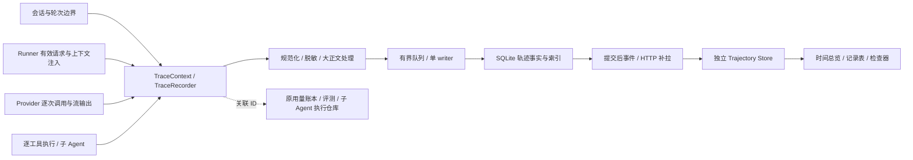

# 知序执行轨迹：对齐 DeepSeek Harness 的实现方案

## 1. 目标与交付形态

在现有聊天页内增加与截图一致的“轨迹”标签。用户无需离开会话，即可检查每一轮模型输入、模型输出、工具调用参数与结果、耗时、异常、重试和子 Agent 活动。日常对话保留原有聊天体验，调试时切换为高密度轨迹台账。

本轮交付源码调研、方案和接口设计，不修改业务代码。用户后续补充“和他一样”作为目标样式和交互约束，沿用最初“充分调研、写实现方案”的阶段范围。

成功回答四个问题：

1. 这一次模型实际拿到了哪些已知输入，为什么产生这次工具调用？
2. 哪个模型尝试／工具最慢，是否发生了重试、降级或拒绝？
3. 工具到底返回了什么，最终答案和前面的中间输出是什么关系？
4. 主 Agent、子 Agent、工具内部模型调用分别属于谁；断线重开后还能否核对？

## 2. 方案选择

| 选择 | 结果 | 取舍 |
| --- | --- | --- |
| 只把 UIMessage 变成表格 | 能快速模仿外观 | 现有消息缺请求快照和精确执行时间，不满足调试目标 |
| **原版轨迹交互 + 知序统一轨迹记录，推荐** | 外观与交互对齐截图，接入现有运行时 | 需要补采集、存储和独立投影，改动边界可控 |
| 重写会话系统／引入外部 tracing 平台 | 可扩大到全系统监控 | 不解决 UI 适配成本，带来额外迁移与部署，不作为本次路线 |

采用第二项。原版可借鉴的是事件模型、视图组织和算法，不把 Cordis 或整个 dsh runtime 嵌入知序。实质复制 MIT 代码时保留版权与许可证，具体依赖在实施时锁定。

## 3. 页面与截图逐项对齐

### 3.1 页面骨架

```text
当前会话标题／现有操作
  对话   轨迹
──────────────────────────────────────────────────
  ◷ 时长   ⊟ 轮次   ⊟ 调用                    搜索
──────────────────────────────────────────────────
  输入    ▏ ▏     ▏         ▏
  模型      ▰▰      ▰▰▰        ▰
  工具        ▰ ▰▰      ▰ ▰       ▰
──────────────────────────────────────────────────
  第 7 轮
  · 用户    暂停，先提交……
  · 助手    收到……
  · 工具    interrupt_agent {…} → …
  · 助手    （仅工具调用）
  · 工具    exec {…} → …
  · 上下文  子 Agent 运行结果……
  · 助手    最终回复……
──────────────────────────────────────────────────
              复用当前会话输入框
              会话统计（沿用可信口径）
```

只复现轨迹工作区，不改造截图之外的项目导航或整套品牌。左侧会话栏、现有标题与输入框复用知序。

### 3.2 标签与状态

- 标题下增加“对话／轨迹”；切换不重新发送请求，不打断生成，不改变模型上下文。
- 首次默认对话；当前会话内记住选择，切换 chat 时重新绑定其独立状态。
- 聊天活动块可提供“在轨迹中查看”，按真实事件／调用 ID 定位；该入口不是唯一入口。
- 两个视图保存各自滚动位置；在轨迹中仍能发送消息和停止任务。
- 后台收集不依赖用户是否打开标签；关闭轨迹视图只暂停其昂贵投影与 DOM 更新。

### 3.3 工具栏

| 控件 | 行为 |
| --- | --- |
| 时长 | 与原版一致，在等宽操作与按实际耗时的紧凑时间轴间切换；后者压缩无活动间隔，不捏造未知耗时 |
| 轮次 | 整体折叠／展开轮次；仍保留轮次标题、状态和可选摘要 |
| 调用 | 整体折叠／展开助手名下工具；嵌套子调用跟随各自父调用 |
| 搜索 | 对当前已加载窗口的名称、参数预览、结果预览、文字和 ID 搜索；标明“已加载 X 条” |

搜索不调用 LLM。首版与原版一样不承诺搜索尚未加载的正文；详情懒加载全文不被错误宣称已参与搜索。较早历史有明确“加载更早”入口。

### 3.4 时间总览

- 输入／模型／工具三条泳道；输入含用户和上下文，模型为紫色系，工具为橙色系，错误／中断加状态提示。状态同时提供文字或形状，不能只看颜色。
- 点击色块定位记录；拖选闭区间后，明细显示所有与区间相交的活动。清除选择恢复当前窗口。
- 滚轮缩放；放大后允许平移；操作提供键盘及明确按钮等价路径。
- 模型可分 TTFT 与生成区间；TTFT 取首个可见内容／reasoning token 的实际时刻，工具事件不当作 token。
- 活动进行中显示起点和“进行中”，终态后填实际跨度；不按页面渲染时刻制造完成时间。
- 真实工具开始、结束在执行边界测量；表格保持模型顺序，时间带呈现实时时序，两者不混为一谈。
- 只画已加载窗口；缺历史前缀时显示省略标记与加载入口。
- 时间带选择使用当前投影坐标；压缩空闲后的坐标不能直接当 epoch 时间传给后端。缩放／筛选都在同一坐标模型中完成；切换时长模式先清除旧选择。原版隐藏的“实际时间”开关不加入首版工具栏，精确 wall-clock 时刻在悬停和详情中查看。

### 3.5 紧凑记录表

- 视觉对齐截图：白／浅灰底、细分割线、约 30px 的常规单行、左侧轮次轨道和类型色签；长参数与结果单行省略，完整内容进检查器。
- 记录类型包含系统、用户、上下文、助手、工具、子工具、压缩；用户轮次与模型请求 step 分开。
- 助手发出工具调用但没有文字，显示“仅工具调用”；不能将其丢掉或伪造成最终回复。
- 同名工具逐次独立；`工具名 参数 → 结果` 只是一行展示，不是存储合同。
- 字符流实时更新当前记录，完成后对同一稳定 recordId 冻结；不多添一行重复最终文本。
- 用户在底部时跟随；向上查看则暂停并显示“有新活动”。向前补页保留阅读锚点。

### 3.6 局部检查器

桌面端选中行打开表格右侧局部检查器，可调宽；复用会话右栏槽位协调机制，不与已有文件预览／工作台强行叠出第三列。窄屏用全屏详情／抽屉并能返回原选中行。

| 记录 | 详情 |
| --- | --- |
| 用户／上下文 | 原始可展示内容、来源、附加媒体引用、归属轮次 |
| 模型请求／助手 | provider/model、请求参数、有效 system／messages／tools、顺序化输出块、返回的 reasoning、finishReason、usage 来源、TTFT、总时延、重试列表 |
| 工具 | 原始参数与标准化有效参数、工具 schema 快照、结果或错误、开始结束、真实耗时、call ID、执行状态 |
| 子 Agent | 关联的 invocation/execution、父工具、子会话轨迹入口；返回父轨迹保留选择 |
| 压缩 | 原因、输入范围、摘要及辅助模型调用，独立标明后台请求 |

提供文本／JSON 查看、复制当前内容；工具输出作为不可信数据渲染，不执行 HTML。只有 provider 真实回传的 reasoning 才可见；不声称能展示模型未公开的内部思考。

## 4. 总体架构



职责约束：

- Trace 是观察域，不成为执行调度器，不决定工具是否被授权，不把轨迹查询塞进 Runner。
- 原 Session 继续负责会话续接和聊天历史；新轨迹记录负责观察事实。这是有意限定的增量方案，不承诺首版完成全系统 event sourcing。
- 单个动作在轨迹域只有一个权威事件生产点；旧 progress 仍可作为聊天投影，不能反向再次写入同一次工具事实。
- 原用量账本保留内容无关合同；Trace 独立保存受控正文，以共享 call ID 关联。
- 子 Agent 仓库继续拥有任务状态，Trace 关联其 execution ID；首版不迁移其数据库。
- 评测 Trace 保留现有 artifact 与判分语义，通过适配器关联，禁止静默变更既有闭集事件或 20MiB 限额。

## 5. 身份与事件模型

层次：`workspace → session → visible turn → run/execution → step/logical request → provider attempt → tool call → child execution`。

- `traceId` 表示一次执行链，主运行创建，子执行沿用；`runId` 标识一次 AgentRunner 执行。后台唤醒产生新 run，保留 triggeredBy 引用。
- `turnId` 复用 WebUI 可见轮次，不用 Runner iteration 冒充；iteration/step 单独存。
- `spanId/parentSpanId` 关联模型／工具／子运行；`executionId` 对接已有子 Agent 调用身份。
- `logicalRequestId` 是一次逻辑模型请求；每次可观测 provider attempt 生成独立 `modelCallId`。模型 fallback 仍属于原逻辑请求，但 provider/model 是该尝试的真实值。
- `toolCallId` 取 provider call ID；为空或同执行内重复时服务端生成独立内部 ID，并保留原始 providerCallId，不按名称去重。
- 同一 session 的持久事件 `seq` 从 1 严格递增，由串行 writer 分配；与旧 `turnSeq`、DeepSeek 从 0 开始的 seq 都分开。
- `eventId` 全局唯一，重试写入和 WS 重放幂等；recordId 稳定跨 partial/final 和向前补页。
- ContextVar 绑定不可变上下文，逐工具／请求 finally reset；不向共享 RequestContext 就地写父子 ID。

事件词汇与读取合同见 [接口契约](../contracts/2026-11-13-trajectory-tracing-contract.md)。

## 6. 后端采集：具体落点与覆盖

### 6.1 会话／轮次／上下文

在 `AgentLoop`／`WebuiTurnCoordinator` 已知真实 session、可见 turn、workspace 的边界创建 TraceContext。注册 turn hook 时传入 recorder；用户输入、实际注入给模型的记忆／检索／系统上下文带来源，避免只记录界面能看到的用户文字。

只有真的加入模型请求的上下文才显示为模型输入；来源仅“准备好”但未使用不能算注入。后台通知若还没被模型接收，可显示投递状态，但不伪造 `context.injected`。

### 6.2 模型请求与逐次尝试

`Runner._request_model` 在 `context_governor.prepare_request` 之后记录规范化有效请求快照，包括 system/messages/tools/generation、上下文状态种类与已知续接标识。保存脱离原对象的深拷贝，避免后续原地修改污染快照。

`providers/base.py` 的 `_safe_chat/_safe_chat_stream` 为逐次包装调用边界，新增独立内容观察协议：started、delta、finished，失败／取消同样闭合。它不能通过 `set_llm_call_observer(trace)` 覆盖已安装的 `record_llm_call`。以组合 dispatcher 或独立 trace sink 接入；单个消费者失败不影响另一个。

`LLMCallRecord` 仅可增补向后兼容的 ID 元数据，仍不装正文。ID 必须在请求开始前生成，usage 和 trace 使用同一个 ID，不能分别在回调后随机造两个。

必须审查 fallback wrapper 与 leaf，规定每个可观测尝试只由叶边界记一次；transport 与 SDK 隐藏重试另标 `attemptVisibility=provider_call`。若适配器能关闭 SDK 隐式重试或提供真实网络尝试钩子，单独验证后才宣称 `transport_attempt`，不得未经验证改变现有重试行为。

规范化请求不是原始 HTTP 报文。opaque continuation 记录已知 delta、continuation 状态是否使用及完整度，未知服务器上下文显示“提供方管理，无法完整展开”。禁止持久化 opaque 私有认证对象。

### 6.3 输出、思考与重试

保留有序内容块：text/reasoning/tool-call/media/unknown。每个 attempt 拥有自己的 partial；失败重试后旧 partial 保留为失败尝试，新 attempt 从新块开始，不能跨尝试串成一句话。

内容分片可在 100ms 或 16KiB 到达时合并存储，保持块内顺序、字符不丢、首末时刻及原 delta 范围；块切换／终态必须先 flush。默认不承诺逐 token 精确回放，另设可选 raw-chunks 调试模式。完整正文、首 token 时刻和每次尝试保留属于首版。

最终 response 是同 attempt 的完成快照，引用其 chunks；不能将 final 当 delta 再追加。取消仍保存已观测到的部分文字，status=cancelled。

### 6.4 工具

在 `agent/tools/execution.py::execute_tool_calls` 收到完整 tool_calls 后、分批／调度之前，为每一项分配内部工具身份并建立 requested 事实；`_execute_tool_call` 外围负责该项校验与执行的闭合，覆盖 repeated lookup、prepare_call 拒绝、参数错误等提前返回。不能只在真正进入分支时才记录 requested，否则前批取消会漏掉后批尚未启动的模型调用意图。取消时未启动项标 skipped，并附 reason=cancelled_before_start；不宣称其工具 body 已被执行。

区分 requested、running、succeeded、failed、denied、cancelled、interrupted、skipped。requested 到 running 之间为排队／准备，不画成已经执行；拒绝是独立终态，不制造一段执行耗时。将原始参数和规范化 params 分开，保存工具 schema 引用。

实际 body 执行前记 started 单调时钟，返回／异常／取消时收口；gather 各分支各自记完成，不等 after_iteration 才生成时刻。返回给模型的错误观察也保存，执行原错误与模型侧添加的 retry hint 区分字段。

Provider-hosted tools 接 `on_provider_tool_event`：明确 origin=provider；只记录返回的信息，缺参数／结果显示未提供。MCP、内建与插件工具走统一执行边界。工具内部调用模型的 span 挂在该工具下；无法观察的外部 MCP 服务内部活动不凭空展开。

### 6.5 子 Agent、后台和辅助调用

普通 spawn 从既有 parentToolCallId/invocationId 接父 trace，子 Runner 新 run/execution，独立步骤。父任务已结束不自动取消仍运行的后台子任务，也不把父状态当子任务终态。

已核对当前 `SubagentManager`：普通子运行沿用 origin 的 session_key，不天然拥有独立子会话。因此子执行默认归属父 session，以 childRunId/executionId 导航到嵌套轨迹；`childSessionId` 只在确实创建了独立会话时填值。UI 显示“查看子执行”，不能为了满足导航虚构一个不存在的子会话。

memory consolidation、extractor、profile extractor、标题生成、压缩、judge 等调用进入同一模型观察协议，用 purpose 与 source 明确归属。能关联 session 时挂入该会话；无会话归属的系统任务保留系统轨迹范围，不能出现在随机聊天里。

首版必须证明主聊天、普通子 Agent、fallback/retry、MCP/内建工具、hosted tool、压缩与已关联辅助调用。评测适配在接口稳定后接同一模型 ID；未支持的第三方直调显式列 coverage gap，不宣称全覆盖。

## 7. 存储、流量与持久语义

### 7.1 本地布局

每个 agent workspace 使用现有 workspace 解析得到的 `<agent-workspace>/runtime/trajectory.db`，与 memory DB、agent-executions.db、评测目录分开。使用标准 sqlite3，WAL、busy timeout、单 writer 工作线程／服务持有连接，迁移有 schema_version；查询不无故创建空库。

表：`trace_runs`、`trace_events`、`trace_spans`、`trace_records`、`trace_bodies`、`trace_session_heads`。events 是轨迹事实，runs/spans/records 是同事务更新的查询投影；正文大于 16KiB 放同 DB body 表，引用 opaque bodyId，避免文件／DB 双写一致性。body 分页读取，不能每页 join 全文。相同有效 prompt／schema 用不可变引用复用，messages 以已有消息块引用＋本次新增部分保存，避免每个 step 重复写整段历史导致空间平方增长；详情仍可组装完整的已知请求。

索引至少覆盖 `(session_id,seq)`、`event_id UNIQUE`、`(run_id,span_id)`、`(session_id,turn_id)`、`(logical_request_id,attempt)`。所有读取叠加 owner/workspace/session 授权，不信任客户端传来的路径。

### 7.2 写入和推送

- 规范化、脱敏后复制入有界队列，writer 每 200ms 或 128 个事件提交一次；这是初始配置目标，不是已测性能保证。
- 关键终态触发优先 flush，不在 Agent 执行协程等待磁盘。提交事务同时分配 seq、更新投影，再发布 durable batch。HTTP 读历史只返回已提交前缀；执行终态和轨迹终态提交分开，尚未提交时 UI 显示“正在保存轨迹”，不能提前表示历史完整。gateway 正常关闭最多等 3s 排空，超时记录未落盘范围，不改变任务 outcome。
- 高频文字由 attempt 内 coalescer 合并；跨 block／tool／request 边界不合并，不做内容抽样。
- 首版仅使用提交后增量给轨迹前端；普通聊天仍走原实时流，所以轨迹允许约一个批处理窗口延迟。
- 全局采集内存按 8192 个待处理项和 64MiB 双限制，计入队列、所有 attempt 的 coalescer、待写正文及写入中批次，不能只限制已入队部分。达到高水位先提早 flush；不能无限等磁盘阻塞模型。当容量仍不足时将该 run 标记 partial、明确缺口并降级停止其正文采集；不能静默扔生命周期后继续显示 complete。
- 磁盘完全不可写时，经原 EventSink 与服务健康状态报告轨迹不可用，原任务继续；内存错误标记不能被声称已持久化。恢复后补 `trace.gap`，重启时遗留运行标 interrupted／完整度 unknown 或 partial。
- 新功能不向 provider 发送额外 trace 提示，不改变工具返回语义，不增加模型 Token。

### 7.3 恢复与清理

重启仅在取得对应 workspace writer 所有权后关闭旧进程遗留活动 span，状态为 interrupted，工具副作用 outcome=unknown；不重跑工具，不把中断补成失败结果或成功。writer 被占用则报告 unavailable，不抢占另一个进程。

默认终态轨迹保留 30 天，活动执行不按年龄删。建议单 run 正文预算 100MiB、单 workspace 轨迹软配额 2GiB，单 body 上限 8MiB；均进入显式配置。预算截断时保留类型、长度、摘要与 unavailableReason，完整度置 partial，UI 清楚提示；这些是新方案建议值，不是原版限制或现有能力。

正文可按最旧终态 run 分批过期，保留 ContentRef 的 expired 状态；事件删除只能清理每个 session 的连续前缀，不能删除夹在活动 run 中间的某个旧 run 事件。前缀边界不得越过最早活动／仍保留运行的必要事实；跨边界的父引用保留元数据 stub。清理后 retainedFromSeq 前移并递增 historyGeneration，原 seq 永不重编号。被活动运行阻挡而无法回收足够空间时，停止新正文持久采集并提示，不制造日志中间空洞。配额统计包括 DB 活跃页、WAL 和正文；批量清理后 checkpoint，空闲页优先复用，不承诺 DELETE 立即缩小文件。历史过期与本来未采集是两种状态。

临时聊天只用内存 recorder，不写轨迹 DB，不复用落盘正文缓存；会话关闭即释放，并受独立明确的内存预算限制。fork 记录 lineage、父边界与 source 引用，不复制父事件重新计数；父轨迹过期时显示不可用。删除会话时按 session 清掉轨迹及正文，跨库清理用幂等任务＋重试，不能假定和原 session 文件原子提交。活跃删除先撤销采集许可并递增该 session 的 captureGeneration；writer 入库前校验 candidate 携带的 generation，丢弃旧代队列／写入重试，防止删除后异步 flush 又创建记录。正文跨请求复用时引用计数与删除同事务，仍有合法引用的块不提前移除。

## 8. 前后端读取与接线

初次取服务端 `trace_records` 投影尾页，默认 200 条记录，最大 500；向前补页。每条记录已经包含已提交的 partial／终态、内容块摘要、开始时刻、请求／schema 引用、父节点 stub 和 recordRevision。不能用原始事件的最后 200 行初始化 UI：尾页可能只有几个 delta 或 tool.finished，缺少开始及先前文本。原始 events 接口留给增量补拉和证据检查，前端不为初始化从 session 起点重放全部 chunks。独立 `features/trajectory/` 包含 types/parser/reducer/client/projection/hook 和纯投影函数，组件放 `components/thread/trajectory/`。

新 HTTP read routes 与现有 WebUI 认证体系一致；WS 仅显式协商 `trajectoryEventsV1` 后订阅。不要给所有 channel 默认推完整正文。

首次记录页在一个 SQLite 读快照内返回 rows 与 snapshotSeq=H，客户端先应用该完整基线，再订阅 afterSeq=H。后续 batch 同时含 events 与受影响 recordUpdates；用绝对记录快照更新预览，禁止把 ContentRef.preview 当完整 delta 文本拼接。服务端补放已提交后缀或返回 resync_required。客户端只以自己已经成功应用的连续事件水位 appliedSeq 重连，绝不能使用服务端 durableSeq（可能高于实际接收水位）。旧页补拉按 recordRevision 合并，不覆盖更晚 live 状态、不推进 appliedSeq。

提交后的通知也可能丢失，尤其最后一批没有后续事件触发序号检查。活跃订阅每 5s 接收 head 水位；发现 durableSeq>appliedSeq 就 HTTP 补拉。head 不承载正文，不推进 appliedSeq；健康静默不产生用户通知。这样不能把“socket 仍在线”误当作已收到最后一条终态。

详情按 recordId/spanId 懒加载，pending 请求绑定 workspace/session/request generation；切聊天、切 workspace 后丢弃旧请求结果。旧 gateway 不支持时明确不可用，不定时重复发失败请求。

请求或工具开始早于尾页时提供边界 stub，补齐后合并到同一记录；不因窗口内只有 result 就虚构工具起点。

## 9. 统计口径

- 模型请求数按唯一 modelCallId，logical request 次数另列；重试与 fallback 不消失。
- 只在同一计费观察层求和；wrapper、父执行汇总和子调用不能同时加第二次。
- 用量来源 reported／estimated／missing 明示，缺失不是 0。缓存读写只有 provider 真实字段才显示比例。
- TTFT、生成速度、工具耗时使用实际观测；并行工具时长不相加冒充 wall time。整轮端到端由轮次起止测量。
- 汇总标明当前加载范围、主／子／辅助范围和 coverage；不把窗口内数当整个会话数。
- 先沿用知序现有可信底部统计，再逐步以可核对 call ID 联动；本次不新造金额估算。

## 10. 数据边界

默认本地标准采集，用户配置可选 off／metadata／standard／raw-chunks；外部上传不属于本次，默认无 collector。standard 必须保存可核对的输入输出，不采用仅摘要冒充完整调试。

规范化 allowlist 排除 apiKey、Authorization、cookie、bootstrap secret、provider 私有认证／续接对象和图片 base64；含已知凭据的文本内容做替换，保留 redacted 标记。URL query 中的 token 也需处理。自由文本不能保证百分百识别未知秘密，设置中说明本地记录会包含用户文件和输出，并提供保留期和关闭入口。

新读取权限使用明确的服务端授权范围：本机管理身份或现有 gateway 管理凭据可读其可见 workspace；绑定聊天的连接只能读该会话及服务器证明属于它的子执行；仅有模型 API 凭据不能读取轨迹。空 caller_chats 不等于全局权限，必须明确具有管理权限才放行。workspace 以入站时的稳定 scope 绑定，客户端不能用路径改写归属。当前是本机自托管身份模型，不声称已有多租户 owner ACL；未来多用户须单独设计。

流式脱敏需要跨分片边界的增量规则／保留尾部缓冲，避免一个 key 被拆成两段后直接落盘；已知秘密匹配失败时保留元数据而关闭该正文，不回退存原文。脱敏在持久化和网络边界前完成，详情仍走同一权限。

所有未知文本安全显示；默认不自动抓取外链媒体。附件保留受控引用，失效则显示不可用。服务错误返回稳定 code，不能把本机路径／SQL／密钥抛到界面。

## 11. 模块改动边界

| 模块 | 拟新增／修改 | 原则 |
| --- | --- | --- |
| `nanobot/trajectory/` | models/context/recorder/store/projection/policy | 集中轨迹领域逻辑，不造通用工作流框架 |
| `agent/runner.py` | 有效请求准备后的窄观察点 | 不把存储和 wire 代码塞进主循环 |
| `agent/tools/execution.py` | 包围完整校验／执行边界 | 覆盖提前返回、取消，保持执行语义 |
| `providers/base.py`、`fallback_provider.py` | trace sink 与 attempt 身份 | 保留 usage observer，防双计 |
| `agent/turn_hooks.py`、`subagent.py`、会话协调 | 上下文传播、子运行、临时内存 | finally reset；不泄漏后台归属 |
| `nanobot/webui/trajectory_routes.py` 与路由注册 | 授权 GET／订阅能力 | 遵守现有认证，详情懒加载 |
| `webui/src/features/trajectory/` | DTO 解析、去重、投影、补拉 | 与聊天 UIMessage reducer 分开 |
| `components/thread/trajectory/` | View/Toolbar/Timeline/Ledger/Inspector | 不复制原版巨型 Table 文件 |
| `ThreadShell.tsx`、`ThreadHeader.tsx` | 标签、槽位和定位入口 | 保持壳层接线小；复用 composer |
| `evaluation/`、`llm_usage/` | ID／适配 | 不改变原内容和判分合同 |
| `config/schema.py`、i18n、tests | 配置与验收 | 不把部署实现细节塞进用户流程 |

## 12. 交付顺序与完成标准

下表是方案级推进顺序，不替代待审实施计划或并行调度单。首版完整交付包含 A–D，不把时间带和真实数据放到无期限后续。

| 批次 | 可验收结果 | 依赖 |
| --- | --- | --- |
| A：事实闭环 | 一次真实会话具备输入→逐模型尝试→逐工具→输出；可历史查询、断线补拉 | 先冻结合同、身份与脱敏 |
| B：截图主视图 | 标签、工具栏、三泳道、轮次表、检查器和 composer 接线 | A 的真实 DTO；纯 UI 可用固定 fixture 先开发 |
| C：复杂链路 | retry/fallback、并行、取消、hosted tool、子 Agent、上下文／辅助调用、临时／fork／删除 | A；与 B 集成 |
| D：完整验收 | 原版交互对照、长列表、异常／崩溃、权限隔离、用量不回退 | A–C |

建议评测统一消费器和外部导出作为后续扩展；首版必须保留现有评测正常运行。总体工作量为跨后端／前端的中型功能，不能按“加一个 Tab”的成本估算；具体人日待实施拆分后给出，不伪造已测工期。

## 13. 验收矩阵

| 场景 | 硬性要求 |
| --- | --- |
| 正常模型→工具→模型 | 顺序与输入输出可核对；不丢中间助手、不重复最终文本 |
| 两工具并行 | 表格保持模型顺序，泳道实际重叠，单工具先完成即可见 |
| 参数错误／未知工具／重复查询拦截 | 均有 requested＋denied/failed；不漏因钩子之前返回的调用 |
| 停止／timeout／进程中断 | partial 保存；取消与失败分开；未知副作用不重放 |
| 首次失败、两次重试后降级 | logical request 和各 attempt 可见，usage 原账本不减少、不重复 |
| 流式 thinking→text→tool | 块顺序正确，未回传 reasoning 明示缺失 |
| opaque continuation | 已知增量和完整度可见，不冒充完整 HTTP 请求 |
| hosted tool／MCP | origin 正确，未知外部内部过程不伪造 |
| 主→子→孙执行 | 父子 ID 正确，不串 chat，返回父轨迹保留选择 |
| 断线同时产生事件 | 基线 H 后按 appliedSeq 补放；服务端 durableSeq 高于已接收值时不跳过事件 |
| 只取尾页且模型已输出 300 个分片 | 记录投影具备已提交 partial；无需重放完整历史，无乱码预览拼接 |
| 旧终态 run 与新活动 run 事件交错 | 只删连续前缀，保留区间无 seq 空洞，正文过期有明确标记 |
| 历史页起点在工具中途 | 边界 stub，无虚构时间；补页行 key 不变化 |
| 临时聊天／fork／删除 | 临时无落盘；fork 不二次计费；删除后不重新写入 |
| 大正文／满盘／锁冲突 | 明示 partial/unavailable，原任务继续，不静默宣称完整 |
| 凭据跨 delta／恶意输出 | 数据库、WS、日志均无测试凭据；HTML 不执行 |
| UI 对照 | 在 1600×1000 对照用户截图结构、密度、三泳道和标签，不出现多余仪表盘卡片 |
| 响应式和可访问性 | 360/768/1024/1600px、浅深色、200% 缩放、键盘、reduced-motion |

性能预算（目标，待实测）：本地单会话已提交事件到可见 p95≤500ms；10,000 条记录仅挂载可见行＋缓冲，目标 DOM 记录行≤150；打开尾页 p95≤1.5s（不含模型生成）；正文检查按需分页／流读取；连续 delta 不重建全量窗口。测试报告注明硬件、窗口大小和样本数，不把网络模型耗时计入 UI 渲染预算。

验证应包括 contract／reducer 测试、执行边界集成测试、SQLite／重连恢复测试、真实 gateway 浏览器验收，以及至少一次用户已有模型配置下的真实调用验收。mock 或静态演示只证明对应层，不代替真实链路；真实调用产生的费用遵循届时用户授权。

## 14. 风险、自检与剩余不确定性

- 已明确原版逐事件日志和知序增量观察域的架构差异，没有承诺首版重写 Session。
- 已比较三条路线，选择依据是截图同款体验与现有核心约束。
- 已覆盖逐次请求、失败 partial、提前拒绝、并发真实计时、父子关系和重连水位。
- 已定义已加载搜索、正文预算、临时会话、fork、删除与 writer 所有权，避免“全部可见”的空泛承诺。
- SDK 内隐式重试、所有第三方 provider 私有输出、外部 MCP 内部调用仍需按适配器证明；coverage 缺口可见。
- 原版源码与用户截图可能不属于同一修订，布局以截图为验收基准，行为以本方案和所读源码为依据。
- 本次未运行产品、不声称测试通过；未修改现有知识库等业务改动，未提交 Git。

### 14.1 环境准备、兼容与回退

- 不新增必需环境变量、API key、collector 或外部服务；现有 gateway 与已配置 provider 足够。开发测试使用独立临时 SQLite 和本地 mock provider，不读取真实聊天正文作为 fixture。
- 安装版本见同日 stack；实施第一步核对 Python、bun、React／TS／Vite 版本，锁定 React Virtual v3 的实际验证版本并更新现有锁文件，运行 `bun run build` 确认兼容后再接数据。不能将方案里的上游 `^3.14.9` 自动视为已验证安装版本。
- Python 预检：`uv run --no-sync python --version`、`uv run --no-sync python -c "import sqlite3; print(sqlite3.sqlite_version)"`；WebUI 预检：`bun --version`、`bun run build`（在 webui 目录）。这些是实施前执行要求，本轮没有运行构建。
- 首次开启只创建独立 trajectory DB，不迁移原 Session、memory、evaluation。老会话显示“开启前未采集”，可附旧聊天定位入口，但不伪造工具时间或输入快照。
- 新 DB 迁移在独占 writer 锁下事务执行，迁移前备份到同一受控运行目录；未知更高版本只读诊断并禁用采集，不能自动降级。关闭功能停止新采集、取消订阅，不删除旧会话数据；恢复旧应用忽略独立 DB 即可。
- 单机初始负载验收包含 4 个并发运行（主任务＋后台子任务）、10,000 条可见记录及 60,000 个原始合并事件；这些是测试目标，不是已达到的容量承诺。无新增集群高可用 SLA。
- 应用崩溃可能损失尚未提交的队列尾部；200ms 只是意图批写窗口，不是硬性 RPO。重启显示 interrupted／unknown，不能用恢复补事件冒充原先已经采到的事实。

### 14.2 本次自检修订

修订 2 修复：重连游标跳跃、原始尾页无法初始化、按 run 清理造成 seq 空洞、子执行被假设为独立会话、时长模式与原版不一致、flush 阻塞执行和空权限范围歧义；字段及验收同步修订。审查证据见同日 document-review。

## Next

- 认可方案后说“写计划”或“制定实施计划”，继续拆成具体文件、任务与验证步骤。
- 希望直接进入开发可说“直接实现”，届时按项目要求补齐必要实施安排。
- 需要修改范围、布局或默认采集策略，直接给修改意见。
