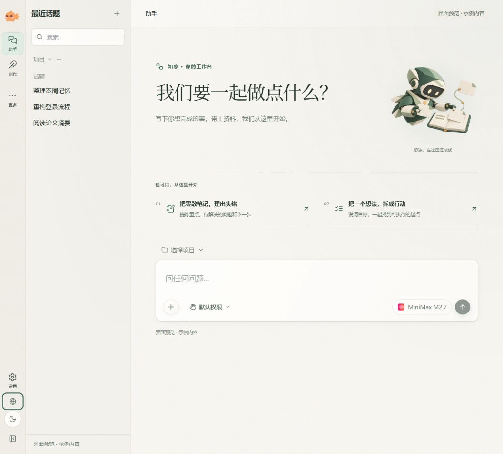
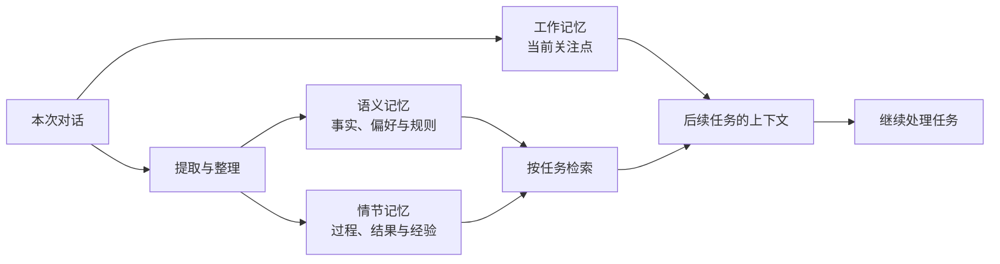
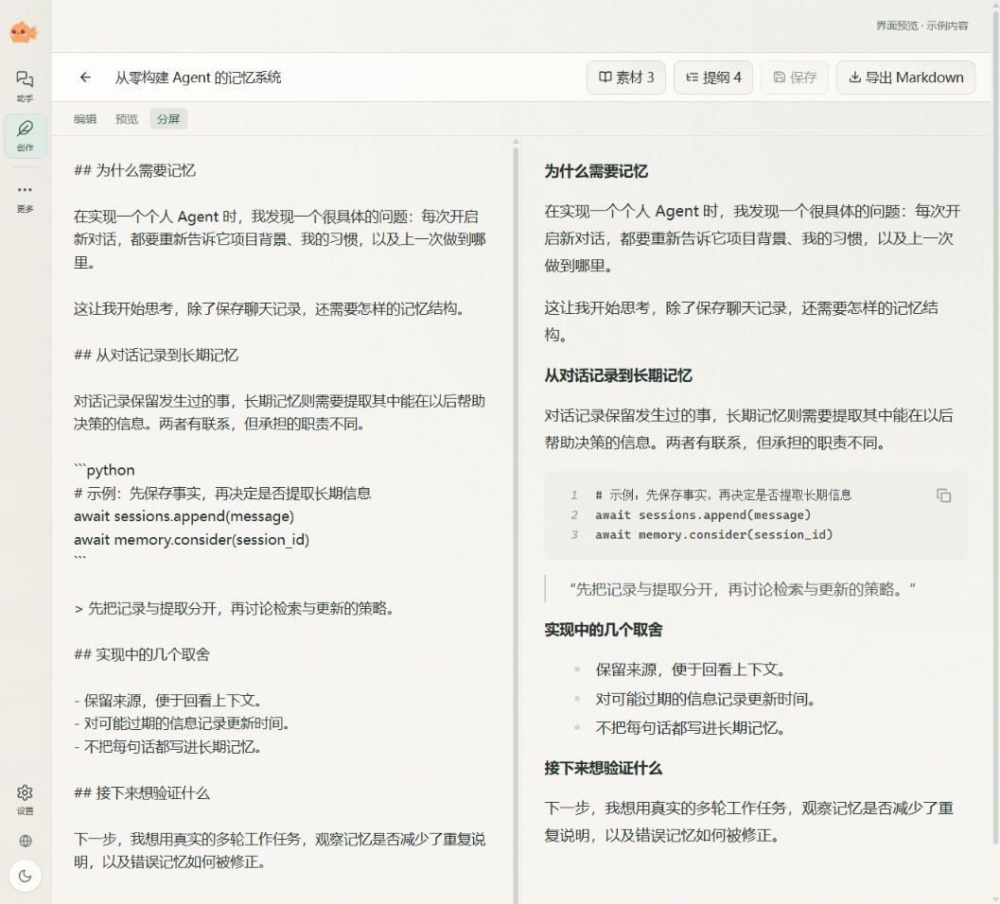
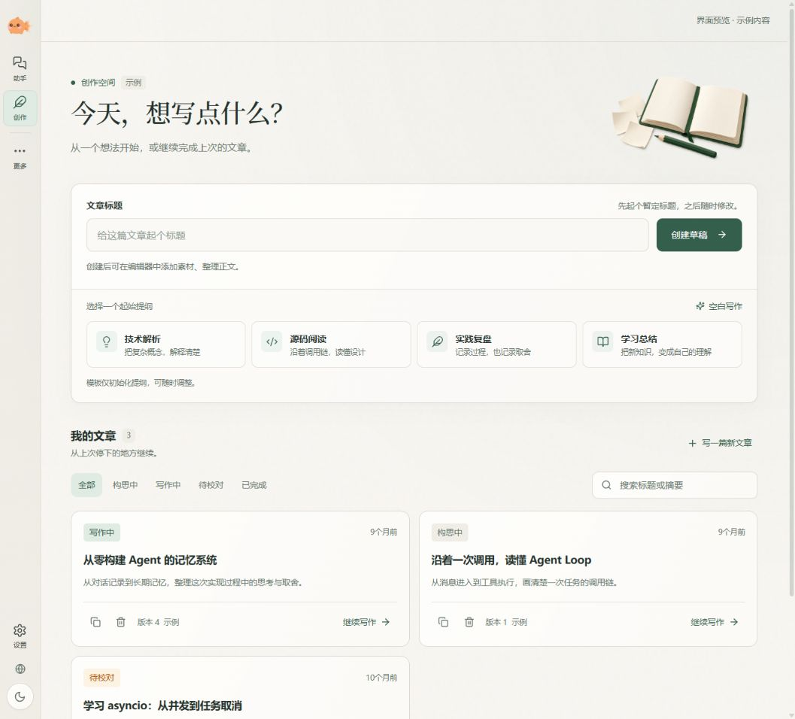
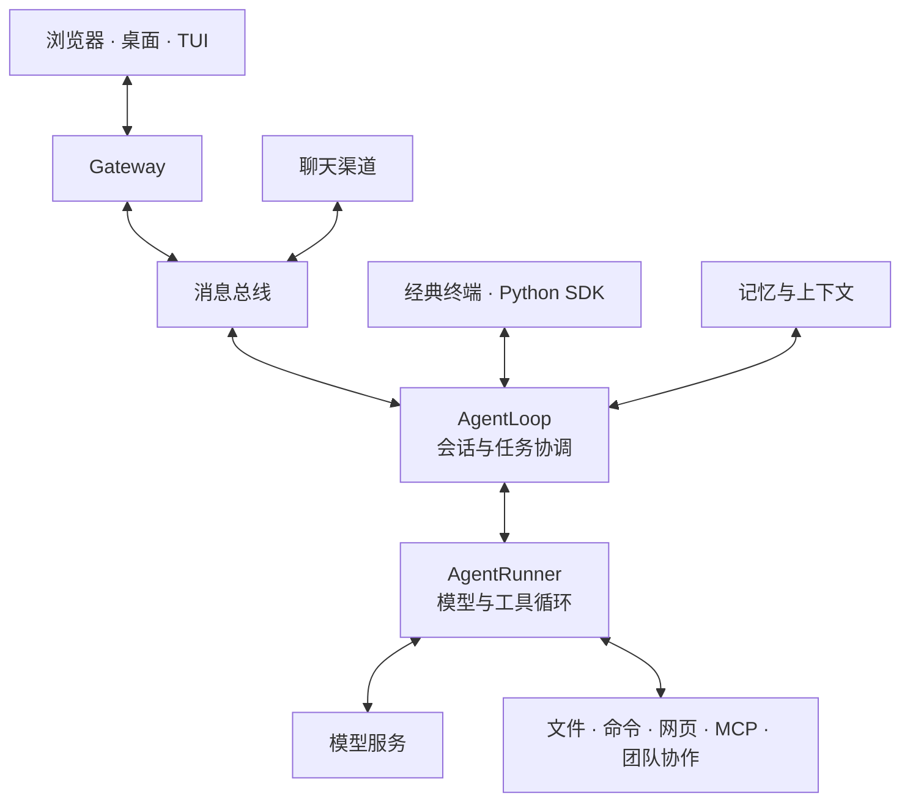

<div align="center">
  

  <h1>知序 Zhixu</h1>

  <p><strong>有记忆、能执行的个人 AI 工作台</strong></p>

  <p>把对话、项目文件和写作放在一起，让经验留下来，让工作接着做。</p>

  <p>
    <a href="#快速开始">快速开始</a> ·
    <a href="#记忆如何帮助工作接续">记忆系统</a> ·
    <a href="#在创作空间里写文章">创作空间</a> ·
    <a href="#开发与扩展">开发与扩展</a> ·
    <a href="https://github.com/wrysmil/Zhixu/issues">反馈问题</a>
  </p>
</div>

---

知序是一个开源、自托管的个人 AI Agent 项目。你可以让它阅读项目、检索资料、处理文件、执行命令，也可以在创作空间里与写作团队一起整理素材、搭提纲、修改文章。

项目围绕三个问题持续开发：**怎样记住有用的背景，怎样把任务做到文件里，怎样让人看得见并参与执行过程。** WebUI 是主要工作入口，同时提供桌面客户端、终端和聊天渠道接入。



<p align="center"><sub>从一个问题、一份资料或一个项目开始。本文截图取自知序的界面预览模式，展示示例内容，不代表真实模型执行结果。</sub></p>

> **当前使用说明**
>
> 本页面向 `feature/desktop-app` 分支的源码版本。界面品牌已改为「知序」，Python 包目录、命令 `nanobot` 和默认数据目录 `~/.nanobot` 仍沿用旧名，下文命令与当前代码保持一致。
>
> 请按下面的源码方式安装知序。`pip install nanobot-ai` 安装的是上游发布包，不能用来获得本仓库的改动。

## 可以用知序做什么

| 场景 | 当前提供的能力 |
| --- | --- |
| 持续处理项目 | 按项目组织会话，在工作台中查看文件、预览内容、使用终端，结合项目目录执行任务 |
| 记住背景与经验 | 维护工作记忆、语义记忆和情节记忆，支持自动提取、检索，以及界面中的查看和管理 |
| 写文章与改稿 | 管理文章、素材和提纲，在编辑器旁与创作团队对话，选中文本后提问或提出修改要求 |
| 让 Agent 动手 | 读写文件、执行命令、搜索和抓取网页，调用 MCP 工具，按需委派子 Agent 或团队成员 |
| 安排重复工作 | 使用定时任务与自动化执行周期性工作，通过网关持续运行 |
| 接入自己的模型和工具 | 配置模型服务与模型预设，使用 Skills、MCP、Python SDK 或 OpenAI 兼容 API 扩展 |

涉及外部模型、搜索、图片生成或聊天平台的能力，需要配置对应服务；知序本身不提供模型账号。

可以从这些具体任务开始：

| 你可以这样说 | 从哪里开始 |
| --- | --- |
| “读一下这个项目，说明登录请求经过哪些模块，把结果整理成一份文档。” | 选择项目目录，在助手中发起任务 |
| “这篇文章先讲问题，再讲实现。帮我调整提纲，保留原来的例子。” | 打开创作空间中的文章，在右侧对话里提出要求 |
| “我习惯先看结论，涉及代码改动时请说明原因。” | 开启记忆后表达偏好，并在记忆页检查和修正提取内容 |

这些是任务表达示例。实际执行依赖模型、工具权限与输入资料；重要修改仍应查看文件和结果。

## 记忆如何帮助工作接续

项目开发、资料整理和写作往往会跨很多次对话。知序把当前进度、长期知识和历史经历分开保存，减少重复交代背景的成本。

| 记忆层 | 关注什么 | 例子 |
| --- | --- | --- |
| **工作记忆** | 眼前在做什么、当前关注点和任务背景 | 正在排查哪个问题，接下来准备处理哪一步 |
| **语义记忆** | 可以长期复用的事实、偏好、规则和经验 | 项目采用的技术方案、你的写作偏好、踩过的坑 |
| **情节记忆** | 某次任务发生了什么、过程和结果如何 | 一次排查尝试过哪些方法，最后怎样解决 |

开启记忆后，系统可在会话空闲等时机提取有用信息，在后续任务中检索相关记忆并补入上下文。Agent 也可以通过 `memory_search` 主动查找历史信息。界面提供语义记忆和情节记忆的查看入口，语义条目支持手动新增、修改和删除。



例如，上次排查登录问题时留下了“已检查连接池，准备核对会话过期逻辑”的进度。下次继续时，相关工作记忆与历史经历可以成为接续线索。上图说明信息如何帮助后续工作，具体提取与召回受触发条件、检索结果和配置影响。

**首次使用时，请在「记忆」页面开启记忆开关。** 当前配置默认关闭；提取与检索效果取决于对话内容、模型能力和配置，自动提取也会产生额外模型调用。检索默认使用全文搜索，可按需配置向量检索。

项目同时保留会话历史与 Dream 记忆整理能力。现有 [记忆指南](./docs/memory.md) 主要介绍历史归档、长期知识文件和 Dream；本仓库的三层记忆实现位于 [`nanobot/memory/`](./nanobot/memory/)。

## 围绕项目开展工作

在 WebUI 中选择项目目录，让会话围绕实际文件展开：

- **对话与执行过程**：查看模型回复、工具调用和任务进展。
- **文件与预览**：浏览项目文件，在工作台里打开内容并查看结果。
- **终端与工作区**：在同一个界面中处理命令、文件和对话，减少窗口切换。
- **模型与团队**：为会话选择模型预设，需要分工时使用 Agent 团队。

例如，可以先让知序阅读一个项目并定位问题，再沿着同一会话继续修改文件、检查结果。相关背景可由记忆系统辅助保留，文件和会话也会成为后续工作的依据。

## 在创作空间里写文章

创作空间以文章为中心：正文在主编辑区，团队对话在右侧，素材、提纲和文章内容属于同一篇稿件。

你可以从一个主题开始，让创作团队协助调研、组织结构、起草和审阅；也可以先自己写，再选中某一段，让 AI 解释、改写或补充。对话支持任务命令和成员提及，团队通过文章工具读取和更新内容。

编辑器提供 Markdown 编辑、预览和分屏，文章支持保存、恢复草稿、查看 AI 改动并撤销，以及导出 Markdown。模型与团队的实际写作质量仍需要你审阅，文章的最终取舍由你决定。



<p align="center"><sub>文章编辑示例：左侧写正文，右侧看排版；素材和提纲按需展开。预览模式不连接写作团队，图中未展示团队对话与实际改稿结果。</sub></p>

<details>
<summary>展开查看创作首页：从提纲模板起稿，或继续已有文章</summary>



创作首页把新建草稿、提纲模板和已有文章放在一起。截图中的文章与状态均为示例数据。

</details>

## 快速开始

### 1. 准备环境并获取源码

需要 **Python 3.11 或更新版本、Git，以及 Node.js 20+ / npm**。WebUI 也支持使用 Bun 安装依赖和构建；原生终端 TUI 的源码运行需要 Bun。

```bash
git clone --branch feature/desktop-app --single-branch https://github.com/wrysmil/Zhixu.git
cd Zhixu
python -m venv .venv
```

激活虚拟环境。Windows PowerShell：

```powershell
.\.venv\Scripts\Activate.ps1
```

macOS / Linux：

```bash
source .venv/bin/activate
```

安装 Python 依赖与 WebUI：

```bash
python -m pip install -e ".[api]"
npm --prefix webui install
npm --prefix webui run build
```

这里的 `api` 依赖包含 WebUI 所需的 HTTP 服务依赖。若使用 Bun，前端两步可替换为在 `webui/` 中执行 `bun install` 和 `bun run build`。

### 2. 启动 WebUI，配置模型

```bash
nanobot webui
```

启动器会准备本地 WebUI 配置、启动网关并打开浏览器。默认地址为 `http://127.0.0.1:8765`，端口以本机配置为准。

进入 **设置 → 模型**，添加模型服务、凭据和模型预设，再发送一条消息确认连接成功。需要记忆时，进入 **记忆** 页面开启开关；需要处理项目时，在界面中选择项目目录。

正常通过启动器打开时会自动认证。如果手动打开地址后出现 Password / Connect 页面，密码来自 `~/.nanobot/config.json` 中的 `channels.websocket.tokenIssueSecret`，为空时回退到 `channels.websocket.token`。

### 3. 选择其他入口（可选）

**桌面客户端**

先完成上面的 WebUI 配置与构建，再从仓库根目录执行：

```bash
npm --prefix desktop install
npm --prefix desktop start
```

桌面客户端基于 Electron，复用同一套 WebUI 与本地网关，启动时会尝试连接或拉起网关。当前桌面壳依赖已安装的 Python 后端，桌面打包配置并不等于包含完整后端运行环境的安装包。桌面开发和打包入口见 [`desktop/`](./desktop/)。

**终端**

配置模型后，可以使用经典交互模式，或发送一条消息：

```bash
nanobot agent --classic
nanobot agent -m "介绍一下你能帮我做什么"
```

安装 Bun 后，`nanobot` 可启动当前源码的原生终端 TUI。

**后台与聊天渠道**

```bash
nanobot gateway --background
```

网关用于持续运行聊天渠道与自动化。飞书、Telegram、Discord、Slack、微信等渠道需要各自配置，见 [渠道指南](./docs/chat-apps.md)。后台运行和服务器部署见 [部署指南](./docs/deployment.md)。

## 数据与模型

会话、记忆、文章和配置由你运行的实例持久保存，默认配置文件为 `~/.nanobot/config.json`。在 WebUI 中选择项目目录，会改变该会话的项目上下文与工具工作目录；它与 Agent 的数据工作区是不同概念。

模型可以连接托管服务、OpenAI 兼容接口或本地模型服务。**自托管指知序运行在你自己的环境中；模型请求发往哪里，由你配置的服务决定。** 配置云端模型时，相关上下文会发送给该服务。

模型接入见 [模型配置](./docs/providers.md) 和 [Provider 配置示例](./docs/provider-cookbook.md)。自定义数据目录、多实例和完整配置见 [多实例指南](./docs/multiple-instances.md) 与 [配置参考](./docs/configuration.md)。

## 开发与扩展

知序采用 **Python + asyncio** 实现 Agent 运行时，**React + TypeScript** 实现 WebUI，桌面端使用 **Electron**。



各入口复用 Agent 核心：模型根据上下文选择工具，工具结果回到执行循环，再形成回复或继续下一步。浏览器与桌面客户端复用 WebUI；具体入口的网关连接方式见 [架构说明](./docs/architecture.md)。

| 目录 | 内容 |
| --- | --- |
| `nanobot/agent/` | Agent 循环、上下文、工具与生命周期钩子 |
| `nanobot/memory/` | 记忆提取、存储、检索与生命周期管理 |
| `nanobot/writing/` | 文章存储、写作会话与文章工具 |
| `nanobot/teams/` | Agent 团队与任务调度 |
| `nanobot/providers/`、`nanobot/channels/` | 模型服务与聊天渠道 |
| `nanobot/webui/` | WebUI 后端接口与服务 |
| `webui/`、`desktop/`、`tui/` | 浏览器、桌面和终端客户端 |

开发 WebUI 时，可在已安装前端依赖的环境中运行：

```bash
nanobot webui --dev
```

更多入口：

- [架构说明](./docs/architecture.md) · [开发指南](./docs/development.md)
- [Skills](./nanobot/skills/) · [MCP 配置](./docs/guides/configure-mcp-tools.md)
- [Python SDK](./docs/python-sdk.md) · [OpenAI 兼容 API](./docs/openai-api.md)
- [自动化](./docs/automations.md) · [问题排查](./docs/troubleshooting.md)
- [文档索引](./docs/README.md)

部分详细指南仍保留上游的安装、发布和社区说明。安装知序请以本页的仓库地址、分支和步骤为准；功能配置请结合当前源码核对。

## 参与项目

欢迎通过 [Issue](https://github.com/wrysmil/Zhixu/issues) 反馈问题、讨论需求，或提交 [Pull Request](https://github.com/wrysmil/Zhixu/pulls)。报告问题时，请附上操作系统、分支或提交版本、复现步骤与必要日志；请隐去日志中的密钥。

## 来源与许可

知序基于 [HKUDS/nanobot](https://github.com/HKUDS/nanobot) 继续开发，在其 Agent 运行时基础上扩展记忆系统、项目工作台与创作空间。感谢上游作者与贡献者提供的基础工作。

本项目遵循 [MIT License](./LICENSE)，保留原始版权与许可声明。第三方组件说明见 [THIRD_PARTY_NOTICES.md](./THIRD_PARTY_NOTICES.md)。
